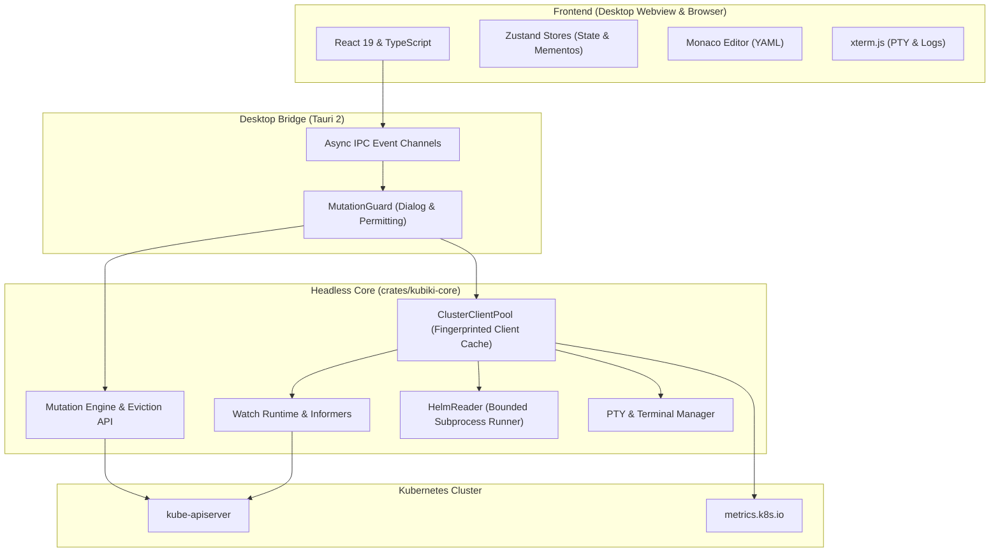

# Kubiki (кубики)

<div align="center">


**The Next-Generation Desktop IDE for Kubernetes**

*Blazing fast, memory-efficient native Kubernetes management desktop application built with Tauri 2, Rust (`kubiki-core`), React 19, Monaco Editor, and xterm.js.*

[Downloads](#-downloads--releases) •
[Features](#-key-features) •
[Architecture](#-architecture) •
[Getting Started](#-getting-started) •
[Keyboard Shortcuts](#-keyboard-shortcuts) •
[Testing](#-testing--verification) •
[License](#-license)

</div>

---

## 📦 Downloads & Releases

Pre-built binaries and native packages for Linux (`.deb`, `.AppImage`), macOS (`.dmg`), and Windows (`.msi`, `.exe`), along with standalone `kubiki-cli` binaries, are automatically built and published on every release:

👉 **[Download the Latest Release](https://github.com/your-username/kubiki/releases/latest)**

---

## 💡 Why Kubiki?

Most modern Kubernetes desktop clients are bloated Electron applications that consume gigabytes of memory, feel sluggish on large clusters, and provide inadequate safety rails when mutating production objects.

**Kubiki** was architected from the ground up to be:
- ⚡ **Lightweight & Blazing Fast**: Cold start in < 500ms, idle memory footprint under 90 MB RAM (up to 15x less than Electron-based alternatives).
- 🛡️ **Two-Phase Mutation Safety**: Never accidentally corrupt production. Server-side diff calculation, atomic `resourceVersion`/`UID` preconditions, cascading deletion warnings, and strict `policy/v1` Eviction API with PodDisruptionBudget verification.
- 📡 **Real-time Live Watch Informers**: Powered by native Rust `kube-rs` informers streaming delta events over asynchronous channels with zero UI freezing.
- 🎛️ **DataGrip & Lens-Grade Ergonomics**: Multi-tab workspace, split-editor support, Monaco YAML editing with in-memory draft preservation, visual cluster topology graph, and interactive xterm.js terminals.

---

## ✨ Key Features

### 🚀 Core Experience & Navigation
- **Multi-Context & Multi-Cluster**: Seamlessly switch between cluster contexts. Supports `$KUBECONFIG` with multiple merged files (using platform-specific `:` and `;` delimiters) and real-time configuration invalidation when endpoints change.
- **Unified Workspace & Tabs**: Multi-tab layout supporting Resource Lists, Resource Details, Monaco YAML Editors, Live Streaming Logs, and Interactive Terminals with split-view capabilities.
- **In-Memory YAML Draft Preservation (Memento Pattern)**: Switching tabs or closing panels preserves your dirty YAML drafts and undo/redo stacks in memory.
- **Full Offline Demo Mode**: Run standalone preview with `?demo=1` to explore the complete interface without needing a live Kubernetes cluster.

### 🛡️ Production-Grade Mutation Safety
- **Server Diff Inspection**: Before applying any YAML change or scale operation, Kubiki queries the live cluster state and displays an exact color-coded diff of changed fields.
- **Atomic Preconditions**: Mutations include strict `metadata.uid` and `metadata.resourceVersion` preconditions to prevent race conditions or overwriting concurrent edits.
- **Cascading Deletion Warnings**: Warns if deleting an object triggers controller-managed cascading deletes (e.g. Namespaces, CRDs, Custom Resources, OwnerReferences).
- **Graceful Node Drain & Eviction**: Uses the Kubernetes `policy/v1` Eviction API rather than raw `DELETE Pod`, honoring PodDisruptionBudgets (PDB). Cancelling a cordon immediately halts the drain workflow.

### 📊 Real-Time Telemetry & Overview
- **Cluster & Namespace Overview**: Aggregated cards for Pod phases, workload health, restart counts, and warning events.
- **Accurate Resource Budgets**: Uses domain-validated `podBudget` calculations (including init containers, sidecars, and pod overhead). Unbounded container limits are accurately recognized, eliminating false OOM warnings.
- **Freshness & Stale Detection**: Live metrics from `metrics.k8s.io` are timestamp-checked; outdated samples (> 2m) or pods recreated after a sample are clearly marked as `Stale`.

### 💻 Terminals, Logs & Port-Forwarding
- **Interactive Container Shell**: Native TTY WebSocket sessions with xterm.js, container switching (init, regular, ephemeral), resize handling, and user consent gates.
- **Host Terminal**: Access your local machine's shell directly within the bottom dock without leaving the IDE.
- **High-Performance Log Streaming**: Live log follow with configurable tail lines, timestamps, previous container logs, and instantaneous client-side regex search.
- **Native TCP Port-Forwarding**: One-click local tunneling to Pods and Services with live traffic statistics and graceful session lifecycle management.

### 📦 Helm 3 & Custom Resources (CRDs)
- **First-Class Helm Management**: List installed releases across namespaces, view release revision history, inspect manifest/values templates, and rollback or uninstall safely with bounded execution.
- **CRD Catalog & Dynamic Resources**: Automatic discovery of CustomResourceDefinitions with custom printer column parsing and dynamic schema tables (Gateway API, FluxCD, Cert-Manager, ArgoCD, Istio, etc.).
- **Privileged Node Debug Shell**: Launch ephemeral privileged debug pods on cluster nodes with automated host filesystem chroot and guaranteed cleanup upon session close.

---

## 🏛️ Architecture

Kubiki is structured into modular layers, separating high-performance systems programming from responsive user interface rendering:



### Key Modules:
- **`crates/kubiki-core`**: Completely headless Rust library and CLI (`kubiki-cli`). Manages Kubernetes clients, informers, port-forwarding tunnels, PTY processes, metrics aggregation, and Helm interactions.
- **`src-tauri`**: Tauri 2 application shell. Exposes secure, audited IPC command handlers with strict input validation, security gates, and graphics fallback mechanisms.
- **`src/`**: Modern React 19 UI styled with Tailwind CSS, utilizing `@tanstack/react-table`, Lucide icons, Monaco editor, and Dockview layout engine.

---

## 🚀 Getting Started

### Prerequisites

- **Node.js**: v20.x or later
- **pnpm**: v9.x or later (`corepack enable && corepack prepare pnpm@latest --activate`)
- **Rust**: 1.85+ (Rust 2024 edition)
- **C Compiler & System Libraries** (for Linux):
  ```sh
  # Debian / Ubuntu
  sudo apt install build-essential libwebkit2gtk-4.1-dev libappindicator3-dev librsvg2-dev patchelf
  # Fedora
  sudo dnf install webkit2gtk4.1-devel openssl-devel curl
  ```

### Quick Start (Development)

1. **Clone the repository**:
   ```sh
   git clone https://github.com/your-username/kubiki.git
   cd kubiki
   ```

2. **Install frontend dependencies**:
   ```sh
   pnpm install
   ```

3. **Run in Desktop Mode** (Tauri + Vite with live reload):
   ```sh
   pnpm tauri dev
   ```

4. **Run in Browser / Demo Mode**:
   ```sh
   pnpm dev
   # Open http://localhost:1420/?demo=1 in your browser
   ```

---

## ⌨️ Keyboard Shortcuts

| Shortcut | Action |
|---|---|
| <kbd>Ctrl</kbd> + <kbd>K</kbd> / <kbd>⌘K</kbd> | Open Command Palette / Quick Resource Search |
| <kbd>Ctrl</kbd> + <kbd>B</kbd> / <kbd>⌘B</kbd> | Toggle Cluster Explorer Sidebar |
| <kbd>Ctrl</kbd> + <kbd>J</kbd> / <kbd>⌘J</kbd> | Toggle Bottom Dock (Terminals & Logs) |
| <kbd>Ctrl</kbd> + <kbd>W</kbd> / <kbd>⌘W</kbd> | Close Current Tab |
| <kbd>Ctrl</kbd> + <kbd>Tab</kbd> | Switch to Next Tab |
| <kbd>Ctrl</kbd> + <kbd>+</kbd> / <kbd>Ctrl</kbd> + <kbd>-</kbd> | Zoom In / Out UI Scale (80% – 200%) |
| <kbd>Ctrl</kbd> + <kbd>0</kbd> | Reset UI Scale to Default (110%) |
| <kbd>Ctrl</kbd> + <kbd>,</kbd> | Open Settings & Appearance Preferences |
| <kbd>Escape</kbd> | Close Modals / Cancel Operations / Dismiss Menus |

---

## 🛠️ Kubiki Core CLI (`kubiki-cli`)

Kubiki includes a headless command-line binary for headless operations, scripting, and CI:

```sh
# Build the CLI tool
cargo build --release --manifest-path crates/kubiki-core/Cargo.toml --bin kubiki-cli

# Run commands
./target/release/kubiki-cli contexts             # List all kubeconfig contexts
./target/release/kubiki-cli current-context      # Print active context
./target/release/kubiki-cli ping [context]       # Verify cluster connectivity
./target/release/kubiki-cli namespaces [context] # List cluster namespaces
./target/release/kubiki-cli crds [context]       # List CRDs with printer columns
./target/release/kubiki-cli metrics [context]    # Node and Pod metrics
./target/release/kubiki-cli helm-releases [ns]   # List Helm releases
./target/release/kubiki-cli helm-repos           # List configured Helm repositories
```

---

## 🧪 Testing & Verification

Kubiki maintains a comprehensive automated testing suite covering unit tests, integration tests, Rust core tests, and end-to-end browser automation:

```sh
# Typecheck TypeScript codebase
pnpm typecheck

# Run Vitest unit tests (293 tests)
pnpm test

# Run Rust tests for kubiki-core (89 tests)
cargo test --manifest-path crates/kubiki-core/Cargo.toml

# Run Rust tests for desktop backend (src-tauri)
cargo test --manifest-path src-tauri/Cargo.toml

# Build production frontend bundle
pnpm build

# Run Playwright E2E browser tests
pnpm test:e2e
```

---

## 🐧 Linux / NVIDIA Graphics Diagnostics

On Linux environments with NVIDIA GPUs and Wayland, hardware acceleration occasionally requires specific driver flags. Kubiki handles this automatically, but provides explicit overrides:

- **Auto Mode (Default)**: Preserves fast DMABUF path and applies synchronization workarounds for NVIDIA/Wayland.
- **Compatibility Mode**: `KUBIKI_GRAPHICS_MODE=compatibility pnpm tauri dev`
- **System Mode**: `KUBIKI_GRAPHICS_MODE=system pnpm tauri dev`
- **CLI Diagnostics**:
  ```sh
  src-tauri/target/debug/kubiki --graphics-info
  ```

---

## 📄 License

Kubiki is licensed under the **[Apache License 2.0](LICENSE)**.

```
Copyright 2026 Kubiki Authors

Licensed under the Apache License, Version 2.0 (the "License");
you may not use this file except in compliance with the License.
You may obtain a copy of the License at

    http://www.apache.org/licenses/LICENSE-2.0
```
