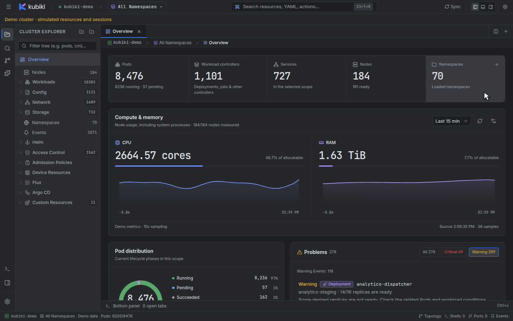
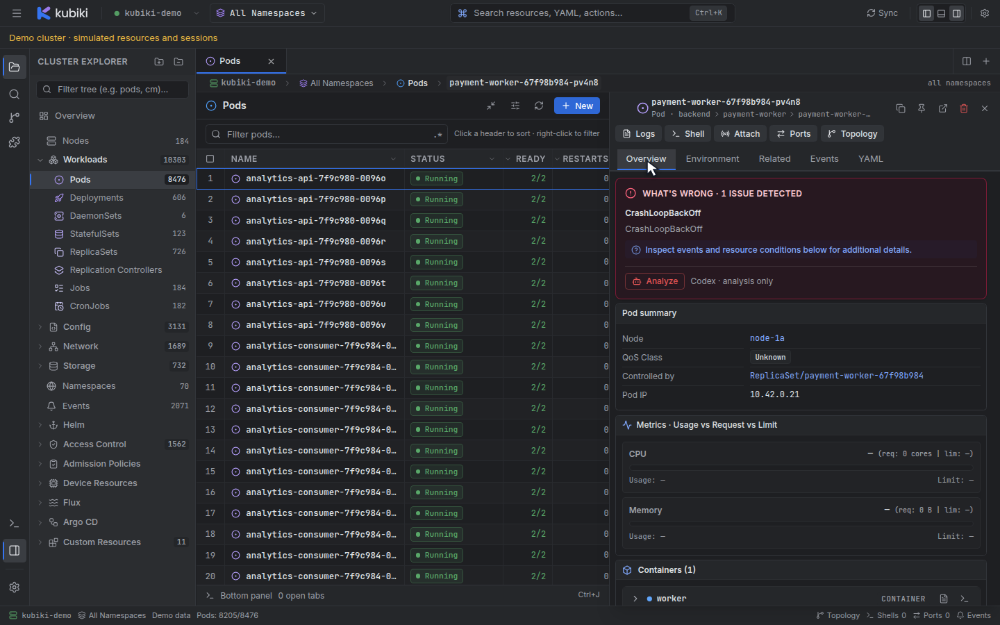
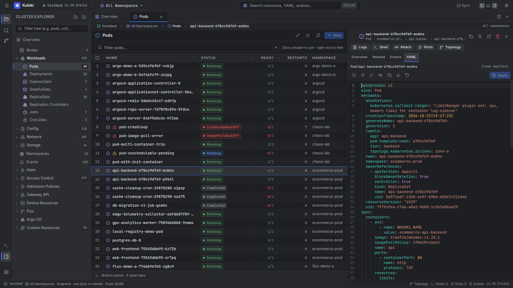
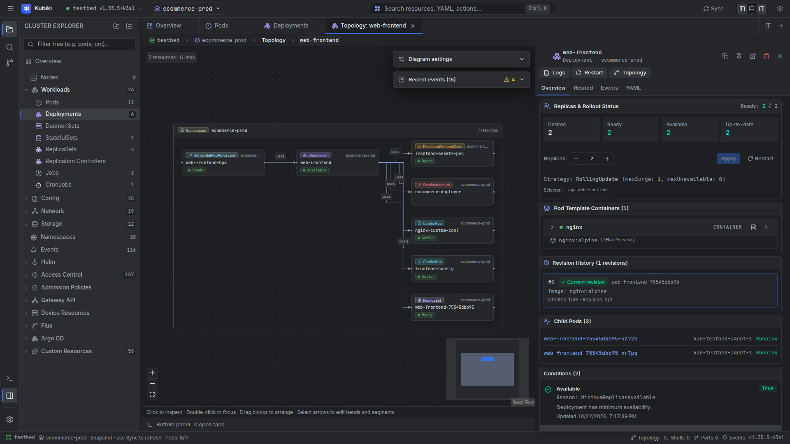
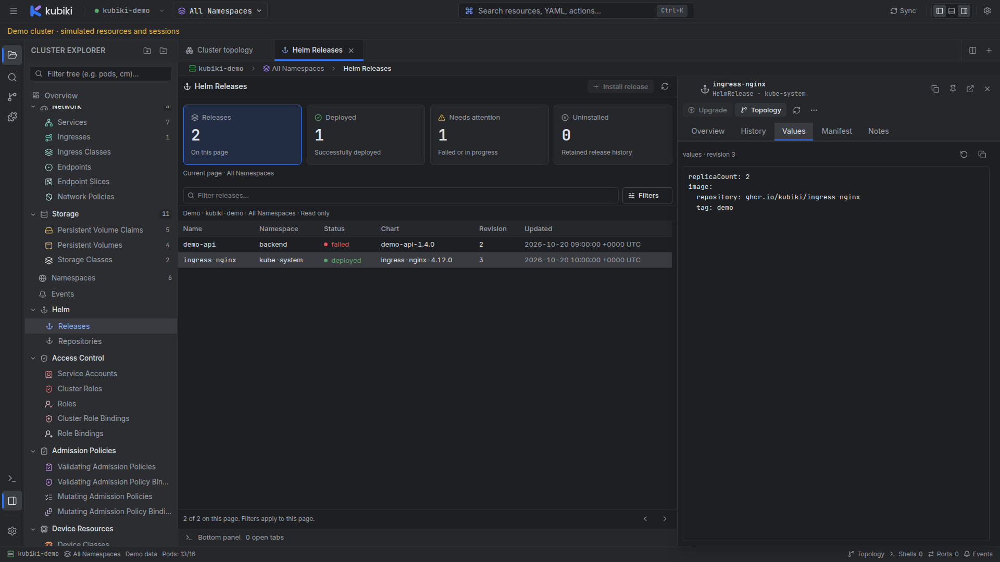
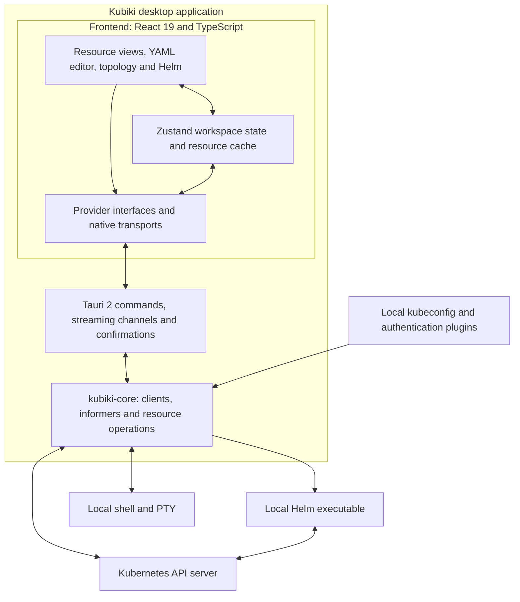

# Kubiki

<picture>
  <source media="(prefers-color-scheme: dark)" srcset="public/brand/kubiki-logo-color-dark.svg" />
  <source media="(prefers-color-scheme: light)" srcset="public/brand/kubiki-logo-color-light.svg" />
  
</picture>

Kubiki is a desktop application for inspecting and managing Kubernetes clusters. It combines resource browsing, workload diagnostics, YAML editing, resource topology, Helm management, logs, terminals, and port forwarding in a single workspace.

## Contents

- [Purpose and capabilities](#purpose-and-capabilities)
- [Screenshots](#screenshots)
- [Installation](#installation)
- [Connecting to a cluster](#connecting-to-a-cluster)
- [Working with Kubiki](#working-with-kubiki)
  - [Resources and workload health](#resources-and-workload-health)
  - [YAML editing](#yaml-editing)
  - [Resource topology](#resource-topology)
  - [Helm releases](#helm-releases)
  - [Logs and terminals](#logs-and-terminals)
  - [Port forwarding](#port-forwarding)
  - [Reviewing changes](#reviewing-changes)
  - [AI analysis](#ai-analysis)
  - [Extensions](#extensions)
  - [Application updates](#application-updates)
- [Architecture](#architecture)
  - [Components](#components)
  - [Data flow](#data-flow)
- [Building and verification](#building-and-verification)
  - [Build requirements](#build-requirements)
  - [Running from source](#running-from-source)
  - [Building desktop packages](#building-desktop-packages)
  - [Verification commands](#verification-commands)
- [Publishing releases](#publishing-releases)
- [Documentation](#documentation)
- [Repository structure](#repository-structure)
- [Keyboard shortcuts](#keyboard-shortcuts)
- [License](#license)

## Purpose and capabilities

Kubiki provides a local workspace for day-to-day Kubernetes administration and investigation. The interface runs in a native desktop window, while a Rust backend connects to the Kubernetes API using credentials from the user's kubeconfig. Helm operations use the locally installed Helm executable.

The application supports switching between kubeconfig contexts and selecting one or multiple namespaces. Resource views, detail panels, YAML documents, and diagnostic sessions can remain open in tabs and split panes.

| Area | Capabilities |
| --- | --- |
| Cluster navigation | Kubeconfig context selection, namespace scoping, API discovery, and custom resource browsing. |
| Resource inspection | Filterable resource tables, configurable columns, metadata, conditions, ownership, events, and references to related objects. |
| Workload diagnostics | Pod and container status, restarts, warning events, and CPU and memory metrics where the cluster exposes them. |
| YAML workspace | Live manifests, clean and full document views, formatting, change review, and drafts retained while navigating within the application session. |
| Topology | Interactive resource relationships, workload ownership, Service connections, Ingress routes, and event context. |
| Helm | Release inventory, revision history, values, manifests, notes, chart search, repository management, installation, upgrades, rollback, and uninstallation. |
| Diagnostic sessions | Streaming container logs, interactive container shells, node debug shells, and local host terminals. |
| Network access | TCP port forwarding to Pods and Services, with active sessions managed in the bottom panel. |
| Cluster changes | YAML updates, scaling, rollout restarts, deletions, and other supported resource actions with confirmation and concurrency checks. |
| AI analysis | Diagnostic snapshots opened in a locally installed Codex, OpenCode or Claude Code CLI, with configurable starting instructions. |
| Extensions | Local or public GitHub package installation, isolated panels, and manual extension updates and rollback. |
| Application updates | Separate stable and dev update channels, signed package downloads and installation after confirmation. |

Kubiki also discovers resources from installed extensions, including Gateway API, Flux, and Argo CD. The available resource types depend on the APIs installed in the selected cluster and the permissions of the active Kubernetes identity.

## Screenshots

The screenshots below use the built-in demo cluster.

### Cluster overview

The overview brings together key resource counts, visible CPU and memory history charts, Pod phase distribution, detected problems, and the highest resource consumers. Charts support keyboard inspection, time ranges, fixed or automatic scales, and pause/resume. Live history is collected while the overview is open; missing metrics stay visibly unavailable instead of appearing as zero.



### Resource inspection

Resource tables and detail panels expose workload state, container information, conditions, and related objects.



### YAML workspace

The manifest editor can be opened alongside resource views to inspect and modify the selected object.



### Topology graph

The topology view displays relationships between workloads, networking resources, and their dependencies.



### Helm workspace

The Helm workspace provides release inspection, revision history, values, and manifests.



## Installation

Download the installer for your operating system from [GitHub Releases](https://github.com/JustYarick/kubiki/releases).

Desktop builds with update signing configured check their own release channel at startup: stable builds receive newer stable releases, and dev builds receive newer dev releases. You can also check from Settings → About → Application updates. Installation requires an explicit restart action and blocks on unsaved YAML edits or running cluster changes. Linux in-app installation uses AppImage; deb/rpm installations use the package manager. See [application updates](docs/APP_UPDATES.md) for runtime behavior and [publishing desktop releases](docs/RELEASING.md) for signing and rollout.

The desktop release workflow targets the following platforms and package formats:

| Operating system | Architecture | Packages |
| --- | --- | --- |
| Linux | x86_64 | Debian (`.deb`), RPM (`.rpm`) and AppImage (`.AppImage`). |
| macOS 13.5+ | Apple Silicon (aarch64), Intel (x86_64), separate builds | Application bundle (`.app`) and disk image (`.dmg`); updater archive (`.app.tar.gz`). |
| Windows | x86_64 | Windows Installer (`.msi`) and NSIS installer (`.exe`). |

On Linux, install the Debian or RPM package using the system package manager, or make the downloaded AppImage executable and launch it. On macOS, choose the build for your processor, open the disk image and copy Kubiki to Applications. On Windows, run the installer; the bundled WebView2 bootstrapper needs internet access if the runtime is missing.

Kubiki bundles the Node.js runtime used by extensions. End users do not need Node.js or pnpm installed. Separate standalone CLI binaries are also attached to desktop releases; the application does not require them.

Before connecting to a cluster, prepare:

- A kubeconfig containing the required cluster contexts and credentials.
- Network access to the Kubernetes API endpoint specified in that kubeconfig.
- Any authentication executables referenced by the kubeconfig, available on the application's `PATH`.
- The `helm` executable on `PATH` if you intend to use Helm features.

On macOS, Kubiki restores the login shell's `PATH` before starting its backend, so a Finder-launched application can find Helm and Kubernetes credential helpers installed through your shell configuration. Both Apple Silicon (`/opt/homebrew/bin`) and Intel (`/usr/local/bin`) Homebrew paths are included as fallbacks. Shell initialization is limited to three seconds; an unavailable or stalled shell does not prevent the application from starting. Restart Kubiki after installing Helm or changing your shell paths.

Desktop Kubernetes reads, watches, logs, exec sessions, and port forwarding use the Rust Kubernetes client. These operations do not require a local `kubectl` executable.

## Connecting to a cluster

1. Place your kubeconfig at `~/.kube/config`, or set `KUBECONFIG` in the environment from which Kubiki is launched. On Windows, the default location is `%USERPROFILE%\.kube\config`.
2. If `KUBECONFIG` lists several files, separate their paths with `:` on Linux and macOS or `;` on Windows. The backend merges their contexts when reading the configuration.
3. Launch Kubiki and select a context from the cluster selector.
4. Select the namespace or namespaces to inspect. Use the all-namespaces scope when appropriate for your access level.
5. Open a resource category in the explorer, then select an object to inspect its details. Open the overview or topology to investigate cluster health and resource relationships.

Authentication follows the selected kubeconfig context. Kubernetes RBAC and admission policies govern the requests made by the application. CPU and memory usage require the cluster metrics API and permission to read its resources.

## Working with Kubiki

### Resources and workload health

Use the explorer to navigate workloads, configuration, networking, storage, access control, nodes, namespaces, and events. Additional categories expose supported extension APIs and custom resources.

Filter and sort resource tables to narrow the current inventory. Select an object to inspect its metadata, status, conditions, events, and related resources. Follow resource references to move between owners, workloads, Services, and dependent objects.

On connection, Kubiki collects a complete inventory of accessible built-in resources, with at most four collections loading in parallel. This initial snapshot provides resource counts and health diagnostics even before their views are opened. Failed or forbidden collections remain visibly incomplete.

Afterward, native Kubernetes watches follow the visible workspace panes and their related resources. Unused collections retain their cached snapshot and stop watching; reopening a view refreshes its data. Pods follow the selected namespaces, except when a Node view needs cluster-wide Pod counts. The overview continuously updates its summary sources; its other inventory counts are marked as cached. Changing context or namespace scope updates subscriptions, and CPU/RAM panels share one metrics poll per context and namespace.

### YAML editing

To create an object, open its resource list and select **New**. Choose a name and, for namespaced resources, one target namespace; edit the starter YAML, then select **Review & create**. The desktop backend reviews the complete manifest before submitting it to Kubernetes. Existing objects with the same name are never overwritten. This also supports discovered custom resource types; their manifests must satisfy the installed CRD schema. Validation errors, denied permissions, and cancelled reviews preserve your draft. Browser access remains read-only; demo creation stores an object in the current session.

Open the YAML view for an existing resource to inspect or edit its manifest. The editor provides syntax highlighting, search and replace, formatting, copying, and downloading.

The default document view omits `status` and `metadata.managedFields` to make editable configuration easier to read. Switch to the full document view when those fields are needed. Unsaved drafts are associated with the context and resource identity and are retained when navigating within the current application session.

To apply a change:

1. Edit the manifest while preserving the resource identity.
2. Select Apply or press `Ctrl+S` on Linux and Windows, or `Cmd+S` on macOS.
3. Review the proposed change in the confirmation dialog.
4. Confirm the operation and inspect the resulting resource state.

The frontend parses YAML and checks the resource name and kind before submission. The backend checks the resource identity and version before committing the update; the Kubernetes API validates the submitted object.

### Resource topology

Open the cluster topology from the activity bar, or open a topology focused on a resource or Helm release. Use the graph to follow workload ownership, Service selectors, routing connections, and other supported relationships.

Select graph nodes to inspect the corresponding resources. The topology includes event context and visibility controls for focusing on relevant objects. Its relationships are derived from Kubernetes resource data; it is a dependency view rather than a network traffic capture.

### Helm releases

Open Helm in the explorer to browse releases in the selected context and namespace scope. Select a release to inspect its status, chart, revision history, values, generated manifests, hooks, and notes. Counts and filters cover every page in the selected scope; failed releases and operations in progress are shown separately. The inventory refreshes every 30 seconds while the window is visible.

The release overview shows Helm's operation description, status of loaded rendered objects, and hook Jobs with their conditions and matching events. An unloaded object is marked as unchecked. Flux-managed releases link to their owning HelmRelease; change that resource to keep reconciliation in sync.

Flux and Argo CD overviews focus on reconciliation issues and recent controller events. Flux groups Kustomizations, HelmReleases, and Sources by readiness; Argo CD keeps application sync and health independent. These views refresh every 15 seconds while the window is visible, preserve the previous snapshot on errors, and report unavailable resource types and event permissions.

Use the release actions to install a chart, upgrade a release, roll back to a previous revision, or uninstall it. Repository management and chart search use the local Helm configuration. Operations affecting a cluster are pinned to the context selected in Kubiki.

Helm changes are prepared for review before execution. Existing releases are checked again after confirmation so that a change in release state can invalidate an outdated review.

### Logs and terminals

Open logs from a Pod and select the container to inspect. Log sessions stream into the bottom panel and remain separate from resource inspection tabs.

Container terminals connect to the selected Pod through the Kubernetes exec API. A local host terminal runs a shell on the machine where Kubiki is installed. Node shells prepare a debug Pod for the selected node and require the corresponding cluster permissions and admission policy support.

Sessions can be managed from the bottom panel. Closing the desktop window stops its tracked watches, log streams, terminals, and port-forward sessions.

### Port forwarding

Start port forwarding from a Pod or Service, select the remote TCP port, and specify a local port. Leave the local port empty or use `0` to allocate a free port automatically.

The listener binds to `127.0.0.1`. Open the forwarded address locally and stop the session from the bottom panel when it is no longer needed. A Service forward resolves a matching running Pod and maps the Service port to its target port.

### Reviewing changes

Resource changes pass through a backend preparation and confirmation flow. The dialog identifies the target and describes the proposed operation. Manual YAML edits include a complete review of the changes. Built-in actions show the operation, its parameters, every target, and relevant warnings. Secret and ConfigMap data edits list changed key names without exposing their values in the confirmation. Batch reviews retain every step; operations whose complete review exceeds the size limit are rejected rather than truncated.

For existing Kubernetes objects, mutation checks use the object identity, UID, and resource version to detect replacement or concurrent edits. If the target changes during review, refresh the resource and review the operation again. Grouped actions share a review and execute their steps sequentially; they are not Kubernetes transactions.

Interactive shell commands execute in their respective shell sessions. They are separate from the confirmation flow used for resource actions in the interface.

### AI analysis

Choose a locally installed and authenticated CLI under **Settings → AI assistant**. **Analyze** in a resource's **What's wrong** panel opens a workspace terminal with the currently loaded diagnostic snapshot. The default instructions request analysis only; starting instructions can be changed in settings. Snapshot data is sent to the chosen agent's configured model provider. See [Resource analysis](docs/AI_ANALYSIS.md) for included data and launch behavior.

### Extensions

Open **Extensions** in the activity bar to install a `.kubiki-extension` file or a package from a public GitHub repository/release URL. Review the source and integrations before enabling it. Installed extensions can be disabled, restarted, updated manually or rolled back when a previous version is available. Node backends execute with your OS user privileges, so choose publishers you trust.

SDK Diagnostics is bundled for extension development and hidden by default. Enable **Settings → Developer → Developer mode** to show it. Redis and Kafka clients are separate extension projects. The SDK, host and author tools are separate workspace packages; see [SDK API](packages/extension-sdk/README.md) and [author tools](packages/extension-tools/README.md).

### Application updates

Signed desktop builds check their own update channel shortly after startup. Stable versions (`1.0.0`) receive only newer stable versions; dev versions (`1.0.1-dev.42`) receive only newer dev versions. Channels never switch automatically. Other preview/test versions, debug builds and unsigned builds do not check for updates. **Settings → About → Application updates** provides a manual check.

The number after `dev` distinguishes successive builds of the same upcoming version: `1.0.1-dev.43` is newer than `1.0.1-dev.42`. The first dev build containing channel-update support must be installed manually, because older dev builds disabled update checks.

Use **Download update**, then **Install and restart** after saving or reverting YAML drafts and finishing active cluster changes. **Later** postpones automatic prompts for a day; **Skip this version** suppresses that exact version. Manual checks override both preferences. Downloaded packages remain in memory for the session; restart closes terminals and port forwards. Linux self-updates use AppImage; deb/rpm installations use the package manager.

## Architecture

Kubiki separates the desktop interface, native command handling, and Kubernetes operations. Tauri hosts the frontend in a system WebView and exposes Rust commands and streaming channels to the interface.



### Components

| Component | Responsibility | Location |
| --- | --- | --- |
| User interface | Resource tables, detail panels, overview, Monaco YAML editor, React Flow topology, and xterm.js terminals. | `src/views/`, `src/components/` |
| Workspace state | Context and namespace selection, resource cache, tabs, split panes, diagnostic sessions, and editor drafts. | `src/state/` |
| Provider layer | Resource access contracts, native command calls, watch subscriptions, and error normalization. | `src/providers/` |
| Desktop shell | Application lifecycle, IPC dispatch, stream ownership, and mutation confirmation dialogs. | `src-tauri/` |
| Kubernetes engine | Kubeconfig parsing, context-specific client pooling, API discovery, informers, metrics, resource mutations, logs, exec, and port forwarding. | `crates/kubiki-core/` |
| Helm integration | Context-specific Helm reads and reviewed lifecycle operations through the local Helm executable. | `crates/kubiki-core/src/helm/` |
| Extension platform | SDK contracts, package tools, local Node controller/workers and isolated extension panels. | `packages/`, `src/extensions/`, `src-tauri/src/extension_commands.rs` |
| Desktop updates | Update state machine, stable/dev channel isolation, signed downloads and guarded installation. | `src/core/app_updates.ts`, `src-tauri/src/update_commands.rs` |

The frontend uses React 19, TypeScript, Zustand, Tailwind CSS 4, Monaco Editor, React Flow, ELK, and xterm.js. The backend uses Rust, Tauri 2, Tokio, and the `kube` client library.

### Data flow

For reads, the frontend sends a request through the provider layer to a Tauri command. The backend resolves the selected context, obtains a Kubernetes client, and requests the resource from the API server. Results return to the interface through the same boundary.

For live resource updates, Rust informers maintain snapshots and produce watch batches. Tauri channels carry those batches to the frontend, where watch sessions update the resource cache and the subscribed views.

For writes, the backend prepares the operation against the current resource state, requests confirmation through the desktop interface, and commits the reviewed operation after the applicable identity and concurrency checks. Helm operations use a corresponding preparation flow and invoke the local Helm executable.

Logs, terminals, and port forwards have explicit session lifecycles managed by the native backend. Local host terminals use a pseudo-terminal; Pod sessions and forwarding communicate with the Kubernetes API.

See [Project structure and architecture](docs/STRUCTURE.md) for a module-level reference.

## Building and verification

### Build requirements

| Dependency | Requirement |
| --- | --- |
| Node.js | Use Node.js 24, matching all CI/release jobs and the extension tools. The bundled extension runtime is pinned separately in `scripts/prepare-extension-runtime.mjs`. |
| pnpm | Version 12.14.0, pinned in `package.json` and the workflows. |
| Rust | Stable toolchain with support for Rust edition 2024. |
| Native build tools | The platform dependencies required by Tauri 2. |

The [Tauri platform prerequisites](https://v2.tauri.app/start/prerequisites/) describe the native toolchain for each operating system, including Xcode command-line tools on macOS and Microsoft C++ Build Tools and WebView2 on Windows.

For Debian or Ubuntu, the project's desktop build dependencies can be installed with:

```sh
sudo apt-get update
sudo apt-get install -y build-essential \
  libwebkit2gtk-4.1-dev libappindicator3-dev librsvg2-dev patchelf libssl-dev
```

### Running from source

```sh
git clone https://github.com/JustYarick/kubiki.git
cd kubiki
pnpm install --frozen-lockfile
pnpm tauri dev
```

`pnpm tauri dev` starts the frontend development server, compiles the Rust backend, and opens the desktop application. The frontend server is started automatically by the Tauri configuration.

The Tauri hooks also prepare the pinned Node runtime and build the extension SDK, tools, controller and bundled diagnostics. The first preparation downloads Node and verifies its official archive checksum. For a browser-only demo, run `pnpm dev` and open `http://localhost:1420/?demo=1`; native operations and extension processes require the desktop application.

### Building desktop packages

```sh
pnpm desktop:build
```

This command runs frontend type checking, builds the production frontend, compiles the native application, and creates the platform packages. For a native build without an explicit target override, packages are written under `src-tauri/target/release/bundle/`.

On Linux, use `pnpm desktop:build:linux`, which includes the AppImage tooling workaround described in [Desktop rendering](docs/DESKTOP_RENDERING.md). Platform configuration files select DEB/RPM/AppImage, macOS app/DMG, and Windows NSIS/MSI targets. Release builds also bundle an extension runtime matching the target architecture. Windows and macOS packages are built on their respective runners.

Local builds do not require updater signing keys and do not automatically enable updater artifact generation. Publish signed application updates through the [release workflow](docs/RELEASING.md).

### Verification commands

Run these commands from the repository root:

| Command | Checks |
| --- | --- |
| `pnpm typecheck` | Frontend, development tooling, and test TypeScript projects. |
| `pnpm test` | Frontend unit and contract tests run by Vitest. |
| `pnpm build` | Extension build, type checking and the production frontend build. |
| `pnpm test:desktop` | Desktop runtime target selection, release tag policy and updater manifest validation. |
| `pnpm test:extensions` | Extension SDK/host/package integration tests; builds extension resources first. |
| `node scripts/check-external-extension.mjs` | Builds the packaged SDK/tools template outside the application repository. |
| `cargo test --manifest-path crates/kubiki-core/Cargo.toml` | Rust core unit and integration tests. |
| `cargo check --manifest-path src-tauri/Cargo.toml` | Desktop Rust backend compilation. |
| `cargo test --locked --manifest-path src-tauri/Cargo.toml --lib` | Native desktop unit tests, including update-channel policy and the update/mutation gate. |
| `pnpm test:e2e` | Browser-driven interface tests run by Playwright. |

Before direct desktop Cargo checks, run `pnpm desktop:prepare` and `pnpm extensions:build` to create the bundled resources. The Tauri CLI runs these steps automatically. Build the extension resources before standalone frontend type checks on a clean checkout as well.

Run `pnpm test:e2e`; Playwright starts the frontend test server automatically, or reuses an existing local server. Install the browser with `pnpm exec playwright install chromium` if needed (`--with-deps` on Linux installs system dependencies too). The default test URL is `http://127.0.0.1:1420`. When using `PLAYWRIGHT_BASE_URL` for a different port, start a server at that URL first; the override does not change Vite's configured port. Browser update tests mock native commands and do not validate OS installers.

## Publishing releases

Follow [Publishing desktop releases](docs/RELEASING.md) for key setup, validation, tags and release recovery. For tests, builds and publication, open **Actions → CI → Run workflow** and leave **trigger_release** enabled. For builds and publication without tests, open **Actions → Release → Run workflow**, leave **run_tests** disabled and **publish** enabled. Pushes to `dev`/`main` and pull requests targeting these branches do not start CI; launch tests manually from Actions. Other branches retain automatic tests and installer builds without publishing. Tag pushes build and publish without enabling tests; use a manual Release run with `run_tests` enabled to test before publication. A plain tag such as `v0.2.0` produces a stable release; `v0.2.0-dev.1` or `v0.2.0-rc.1` produces a prerelease. The workflow uses the tag to synchronize embedded desktop versions and publishes automatically after every target and updater manifest passes. The source branch does not determine the release channel.

## Documentation

- [Test suites, browser coverage and timing reports](docs/TESTING.md)
- [Local state persistence and topology rendering settings](docs/LOCAL_STATE.md)
- [Publishing desktop releases](docs/RELEASING.md)
- [Application updates and signing](docs/APP_UPDATES.md)
- [Project structure and architecture](docs/STRUCTURE.md)
- [Workspace extensions](docs/EXTENSIONS.md) and [extension architecture](docs/EXTENSION_PLATFORM.md)
- [Resource analysis](docs/AI_ANALYSIS.md)
- [Desktop rendering investigation and platform validation](docs/DESKTOP_RENDERING.md)
- [Shared tab metrics](docs/UI_TABS.md) and [resource icons](docs/ICONS.md)

## Repository structure

```text
kubiki/
├── src/                        React interface and application logic
│   ├── components/             Workspace layout, resource details, dialogs, terminals
│   ├── core/                   Resource relationships, diagnostics, layout, utilities
│   ├── navigation/             Command palette
│   ├── providers/              Resource contracts and native transports
│   ├── state/                  Zustand stores and resource synchronization
│   └── views/                  Overview, resources, YAML, topology, Helm
├── src-tauri/                  Tauri desktop application and Rust IPC commands
├── crates/
│   └── kubiki-core/            Rust Kubernetes engine
├── packages/                   Extension SDK, author tools and local runtime controller
├── extensions/                 Bundled SDK Diagnostics extension
├── scripts/                    Extension builds, runtime preparation and release helpers
├── shared/                     Resource type registry shared by frontend and tooling
├── server/                     Local bridges for frontend development and tests
├── tests/                      Frontend, native integration, desktop, browser and performance checks
├── docs/                       Architecture reference and screenshots
├── public/licenses/            Bundled font and extension icon license notices
└── .github/workflows/          Verification and desktop release builds
```

## Keyboard shortcuts

Use `Ctrl` on Linux and Windows or `Cmd` on macOS for the modifier shown below.

| Shortcut | Action |
| --- | --- |
| `Ctrl/Cmd+K` | Open the command palette to search resources and actions. |
| `Ctrl/Cmd+B` | Toggle the explorer sidebar. |
| `Ctrl/Cmd+J` | Toggle the bottom panel. |
| `Ctrl/Cmd+W` | Close the active workspace tab. |
| `Ctrl/Cmd+,` | Open settings. |
| `Ctrl/Cmd+S` | Apply the manifest when the YAML editor is focused. |
| `Ctrl/Cmd+Plus` or `Ctrl/Cmd+Equals` | Increase the interface scale. |
| `Ctrl/Cmd+Minus` | Decrease the interface scale. |
| `Ctrl/Cmd+0` | Reset the interface scale to its default value. |

When a terminal is focused, `Ctrl+K`, `Ctrl+B`, `Ctrl+J`, and `Ctrl+W` are passed through to the terminal.

## License

Kubiki is distributed under the [Apache License 2.0](LICENSE).

Bundled fonts retain their respective licenses:

| Asset | License |
| --- | --- |
| Inter | [SIL Open Font License 1.1](public/licenses/Inter-OFL.txt) |
| JetBrains Mono | [SIL Open Font License 1.1](public/licenses/JetBrainsMono-OFL.txt) |
| Nerd Fonts Symbols Only Mono | [MIT License](public/licenses/NerdFontsSymbolsOnly-LICENSE.txt) |
