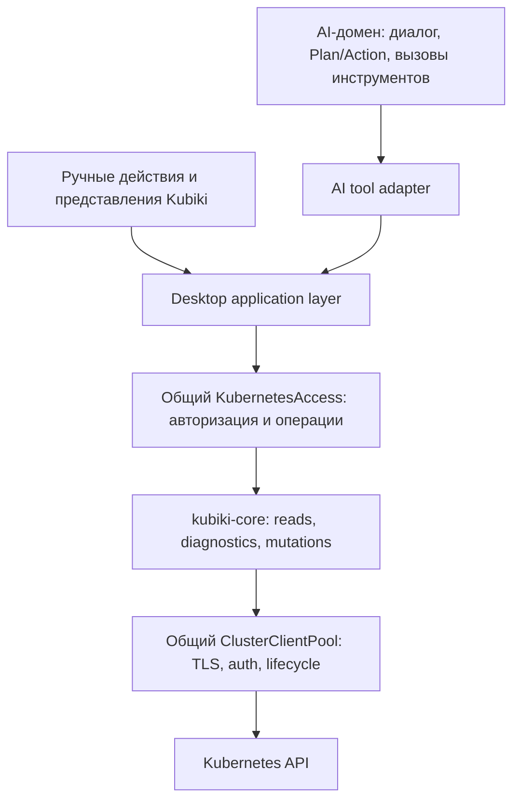

# План развития AI-агента Kubiki

Дата: 2026-10-30. Статус: согласованные требования и план следующих этапов.

Документ описывает **целевое поведение**, а не перечень уже реализованных возможностей.
Текущее состояние описано в [AI_AGENT.md](AI_AGENT.md), архитектурное решение —
в [ADR-003](decisions/003-shared-kubernetes-access-and-ai-phases.md).

## Приоритеты

1. Общий доступ к Kubernetes и обязательные ограничения Plan на backend.
2. Глубокая диагностика с проверяемыми источниками и объяснением причин.
3. Гибкие и понятные правила доступа.
4. Оформление планов и результатов в Markdown.
5. Удобный чат: история, сессии, поиск и управление контекстом.
6. Ограниченные действия над существующими объектами.
7. **Создание ресурсов, установка приложений и развёртывание — в последнюю очередь.**

Архитектурная подготовка первого этапа должна обслуживать диагностику и не
превращаться в отдельную длительную перестройку всего приложения. Существующие
инструменты записи не расширять до выполнения предыдущих этапов.

## Что уже есть и что нужно изменить

| Область | Сейчас | Следующее изменение |
| --- | --- | --- |
| AI-домен | `crates/kubiki-ai` и `src/domains/ai` | Сохранить отдельный домен без собственного Kubernetes-ядра |
| Подключение | AI получает клиент из общего `ClusterClientPool` | Убрать прямые Kubernetes reads/discovery из AI-адаптера за общий сервис операций |
| Доступ | Read only / Ask / Accept и backend policy | Добавить независимый Plan / Action с жёстким запретом изменений в Plan |
| Чат | Streaming и Markdown с таблицами, разговоры в памяти | Типизированные блоки планов, история сессий, поиск, управление контекстом |
| Диагностика | Get/list, Events, ограниченные логи, Pod metrics | Связанные расследования, предыдущие логи, timeline, сравнение состояния, evidence |
| Правила | Переключатели и упорядоченные правила ресурсов | Профили, объяснение решения, проверка конфликтов, раздельные права на поля и инструменты |

## Единая точка доступа к Kubernetes

Пользователь и агент работают с **одним подключением Kubiki к выбранному кластеру**:
один менеджер kubeconfig, общий пул клиентов, TLS/auth, discovery, lifecycle и
обработка ошибок. У AI нет отдельного kubeconfig, учётной записи или способа
подключиться в обход приложения. Подключения к моделям AI остаются отдельной
настройкой: они не являются подключениями к Kubernetes.

Общий сервис `KubernetesAccess` — внутренняя Rust-граница над существующим
`kubiki-core`, а не новый процесс, сервер, порт или второй Kubernetes-клиент.
Название сервиса предварительное; его ответственность фиксирована.



- [ ] Общий контракт операций: catalog/discovery, get/list, metadata, Events,
  logs, metrics, relationships и диагностические запросы. Существующие core
  сервисы переиспользуются; одинаковую операцию не реализовывать отдельно для AI.
- [ ] Прямые `kube::Api` и `Discovery` из `agent_tools.rs` перенести в общий core
  read/diagnostic слой. AI-адаптер только валидирует tool arguments, передаёт
  полномочия и преобразует результат в ограниченный ответ для модели.
- [ ] Отдельные полномочия вызывающего: пользователь или агент, окно, сессия,
  scope, версия подключения, policy revision и фаза. Эти данные формирует backend.
- [ ] Права агента — дополнительное ограничение возможностей приложения.
  Итоговые Kubernetes-права всегда ограничены RBAC текущего подключения.
- [ ] Общие типы ошибок, пагинация, лимиты, timeout, cancellation и признак
  свежести. Cache/watch можно переиспользовать только с проверкой scope и прав:
  полный UI-кэш никогда не становится контекстом модели автоматически.
- [ ] Запрещённое содержимое не загружать ради последующей маскировки: для
  metadata-only использовать соответствующие Kubernetes metadata APIs.
- [ ] Смена kubeconfig, fingerprint подключения или активного context приостанавливает
  агентские операции, отменяет ожидающие действия и требует явного перепривязывания
  разговора. Агент не продолжает работу со старым сохранённым `Client`.
- [ ] Общие ограничения нагрузки с резервом для UI: диагностика AI не должна
  занимать все слоты чтения и мешать пользователю работать с кластером.

«Одно подключение» означает общий источник конфигурации, авторизацию и жизненный
цикл на context; Kubernetes watch и параллельные reads могут использовать несколько
HTTP-запросов. Если пользователь выбирает другой кластер, это явно другое подключение,
общее для его интерфейса и агента.

## Две независимые оси: фаза работы и разрешение изменений

**Фаза работы:** `plan | action`. **Режим доступа:** `read_only | ask | accept`.
Один не заменяет другой.

| Режим доступа | Доступные фазы | Фаза по умолчанию | Изменения Kubernetes |
| --- | --- | --- | --- |
| Read only | Только Plan | Plan | Запрещены |
| Ask | Plan и Action | Plan | Только в Action, в пределах policy и с подтверждением конкретной операции |
| Accept | Plan и Action | Plan | Только в Action и в пределах policy; отдельное подтверждение для каждой разрешённой операции не требуется |

- [ ] Каждый новый и восстановленный разговор открывается в **Read only + Plan**.
- [ ] Выбор Ask или Accept оставляет Plan. Само изменение режима ничего не запускает.
- [ ] В Plan доступны только разрешённые чтения и локальные артефакты ответа.
  Запрещены Kubernetes writes, exec, debug pods, port-forward, Helm install,
  изменение настроек/правил приложения и любые обходные команды.
- [ ] Сохранение плана/сообщения выполняет host как часть чата. Оно не выдаёт
  модели произвольного доступа к файловой системе или права изменить конфигурацию.
- [ ] Переход в Action — явное действие пользователя. Текст сообщения, Markdown
  checkbox и просьба модели не могут переключить фазу или подтвердить операцию.
- [ ] Переход в Action разрешает обсуждение/подготовку выполнения, но не запускает
  накопленные действия автоматически. Выполнение выбранной версии плана начинается
  отдельным явным действием; прямой пользовательский запрос в уже выбранном Action
  может начать новый run в его пределах.
- [ ] В Read only Action недоступен и в UI, и в native API. Принудительный downgrade
  из Action переводит сессию в Plan и отзывает ещё не отправленные изменения.
- [ ] Перед фактическим dispatch заново проверяются phase, access mode, policy,
  connection generation и отмена. Разрешённый tool list также фильтруется по ним.
- [ ] Stop/возврат в Plan отменяет подготовку и pending approval. Уже принятый
  API-сервером запрос может завершиться; это отражается в receipt без обещания отката.

Два переключателя видны рядом: сначала **Plan / Action**, затем **Read only / Ask /
Accept**. Под ними — краткое объяснение эффективных прав. Переключение вкладок
Explorer / Topology / AI сохраняет разговор и не означает переключение в Action.

## Диагностика: главный следующий продуктовый этап

### Инструменты чтения

- [ ] Workloads: desired/current/ready replicas, rollout status, условия,
  generation/observedGeneration, владельцы и цепочка Deployment → ReplicaSet → Pod.
- [ ] Pods: scheduling, readiness/liveness/startup, restarts, last termination,
  OOM, exit code, image pull, requests/limits, доступные metrics и их время получения.
- [ ] Логи выбранного контейнера: текущие и `previous`, init containers,
  временной интервал, timestamps, поиск и пагинация в рамках лимитов.
- [ ] Events: связать по UID, объединить повторы, построить timeline; отсутствие
  Events после TTL или отказа доступа не трактовать как отсутствие проблемы.
- [ ] Сеть: Service selectors, Pod readiness, EndpointSlice, Ingress/Gateway,
  ссылки на backend и пассивный анализ NetworkPolicy. Активные пробы и exec
  выделять в отдельные возможности и не маскировать под безопасное чтение.
- [ ] Storage: PVC/PV/StorageClass, binding, provisioning, mount/attach Events,
  access modes и ограничения topology.
- [ ] Nodes: conditions, pressure, taints/tolerations, capacity/allocatable,
  влияние на выбранные workloads и ограничения планирования.
- [ ] Конфигурация: ссылки на Secret/ConfigMap, отсутствующие ключи/объекты и
  противоречия в настройках только в пределах разрешённого чтения. Поля Pod spec,
  env, annotations и логи тоже могут содержать секреты.
- [ ] CRD/GitOps/Helm: сначала диагностическое чтение статусов и ссылок через
  общие сервисы приложения. Reconcile, upgrade и install пока не добавлять.

### Как агент должен расследовать

- [ ] Начать с вопроса, scope и доступных данных; собрать факты, сформировать
  гипотезы, провести разрешённые проверки и обозначить неизвестное.
- [ ] Для каждого вывода хранить evidence: context, GVK, namespace/name, UID,
  resourceVersion при наличии, capturedAt, инструмент, фильтры и покрытие данных.
- [ ] Ответы инструментов включают `complete | partial | denied | unavailable`,
  причину усечения и свежесть. Не предлагать права шире необходимого автоматически.
- [ ] Ограничивать объём логов, число связанных объектов, шаги, время, токены и
  параллельные запросы. Следующие страницы запрашивать осознанно, сохраняя cursor.
- [ ] Кнопка «Разобрать ошибку» открывает Plan с идентичностью объекта. Снимок
  всего UI и секретные поля автоматически в prompt не добавляются.
- [ ] Показывать отдельно: наблюдение, вероятная причина, доказательство,
  дополнительная проверка и возможное исправление. Не выдавать гипотезу за факт.

Критерий готовности: воспроизводимые расследования Pending, CrashLoopBackOff,
OOMKilled, ImagePullBackOff, неготового Service, зависшего PVC и проблем rollout;
для каждого — ссылки на доказательства и корректное поведение при запрете данных.

## Гибкое управление правилами

- [ ] Профили: минимальная диагностика, workloads, сеть, storage и пользовательские.
  Новые разрешения требуют явного изменения настроек пользователем.
- [ ] Scope: context, namespace, API group/version/resource, kind, name и labels.
  Отдельно — cluster-scoped ресурсы и чувствительные типы.
- [ ] Разделить операции: metadata/get/list/watch, Events, logs/previous logs,
  metrics, чтение конфигурации, а позже — конкретные виды изменений.
- [ ] Данные: none/metadata/selected fields/content, allowlist/denylist полей,
  Secret и ConfigMap отдельно; ограничения env, annotations, log payload и CRD.
- [ ] Разделить право прочитать данные в приложении, передать их модели,
  сохранить в истории и экспортировать. Локальная модель не получает больше прав
  только потому, что endpoint локальный.
- [ ] Объяснение решения: «почему можно/нельзя», какое правило сработало,
  preview на конкретном объекте и инструменте без отправки данных провайдеру.
- [ ] Валидация правил: конфликты, перекрытия, недостижимые исключения,
  предупреждение перед широким разрешением и сравнение изменений профиля.
- [ ] Семантику определить явно: ограничения Plan, RBAC, scope и запрет capability
  нельзя обойти ресурсным исключением. Для ресурсных правил целевая модель —
  запрет по умолчанию, явные разрешения и приоритет явного deny.
- [ ] Текущий first-match формат мигрировать через версию policy и просмотр
  изменений эффективных прав. Не менять смысл сохранённых правил незаметно.
- [ ] Ужесточение правил немедленно отзывает будущие действия. Собранные раньше
  чувствительные tool outputs не пересылать повторно под новой более узкой policy:
  очистить/пересобрать контекст либо предложить новую сессию.

Критерий готовности: пользователь может разрешить диагностировать конкретный
workload в одном namespace без Secret content и исключить отдельные поля;
интерфейс объясняет результат, backend проверяет его до чтения и отправки модели.

## Markdown-чат и отдельный блок плана

Обычные ответы уже используют Markdown с таблицами. Сохранить этот формат для
заголовков, списков, цитат, ссылок и code blocks; форматированный ответ не должен
зависеть от конкретного провайдера модели.

- [ ] `PlanArtifact`: ID, версия, title, `bodyMarkdown`, ссылки на evidence,
  context/scope, дата, revision policy и proposed action references.
- [ ] План приходит отдельным типизированным событием/результатом инструмента,
  валидируется и отображается карточкой «План», а не распознаётся как команда из
  произвольного Markdown. Невалидный ответ остаётся обычным текстом без кнопки выполнения.
- [ ] Карточка: красиво отрисованный Markdown, раскрытие, копирование,
  просмотр исходника и экспорт `.md` по действию пользователя.
- [ ] Новая редакция — новая версия. Утверждение/запуск связывается с конкретной
  версией и scope; позднее изменение Markdown не меняет утверждённый набор операций.
- [ ] Статусы `draft / ready / running / completed / failed / cancelled / stale`
  меняет host по фактическим событиям. Checkbox в тексте не подтверждает выполнение.
- [ ] Кнопки «Уточнить», «Пересобрать по свежим данным» и позднее «Перейти к
  выполнению». В Read only кнопки выполнения нет.
- [ ] Raw HTML, скрипты и внешние изображения не исполняются/не загружаются.
  Экспорт и Markdown-ссылки не становятся способом прочитать локальные файлы.

Пример содержимого диагностического плана:

```md
# Диагностика payment-worker

## Цель
Определить причину Pending без изменения ресурсов.

## Область
Текущий кластер, namespace backend, workload payment-worker.

| Проверка | Источник | Ожидаемый результат |
| --- | --- | --- |
| Причина scheduling | Pod conditions и Events | Конкретное ограничение |
| Доступность storage | PVC/PV status | Bound или причина задержки |

## Ограничения
Содержимое Secret недоступно. Логи ещё не запрашивались.

## Результат
Факты и ссылки на объекты, гипотезы, следующая разрешённая проверка.
```

## Развитие чата и сессий

- [ ] История сессий: названия, переименование, закрепление, архивирование,
  удаление, группировка по cluster/namespace и дата последней активности.
- [ ] Поиск: по заголовку и тексту, в текущем разговоре и по сохранённым сессиям,
  фильтры по scope/дате, подсветка и переход к сообщению.
- [ ] Локальное хранение через native storage, schema version и миграции.
  Выбрать SQLite на этом этапе; это встроенная БД, отдельного сервера не требуется.
  Политика retention и opt-out задаются до включения сохранения содержимого.
- [ ] Чувствительные tool outputs по умолчанию не сохранять. Provider credentials
  остаются в OS keyring, история и поисковый индекс их не содержат.
- [ ] Восстановление не продолжает run, approval или Action. Разговор открывается
  в Read only + Plan, старые evidence отмечены как исторические.
- [ ] Новое сообщение, редактирование/повтор запроса, branching от сообщения,
  остановка генерации, копирование и экспорт выбранной сессии в `.md`.
- [ ] Управление контекстом: что отправится модели, использованный бюджет,
  исключение источника, явное обновление evidence и контролируемая compaction.
  Сводка не расширяет права и не заменяет ссылки на исходные доказательства.
- [ ] Смена модели/провайдера показывает, какие данные могут попасть новому
  endpoint, и заново проверяет egress policy. Историю не пересылать автоматически.

## Действия и развёртывание — последующие этапы

После готовности диагностики, правил, Plan и чата развивать ограниченные операции
над существующими объектами: например, scale/restart, с точным review в Ask,
receipt и разрешённой проверкой результата. Общий mutation executor используется
и вручную, и агентом; подтверждения не переносятся между операциями или версиями плана.

**Последний этап:** создание ресурсов, сценарий «создай Nexus», multi-resource
планы, Helm/GitOps, preview/diff, preflight, зависимости, поэтапное применение и
проверка готовности. YAML generation остаётся предложением, пока host не выполнил
разрешённые операции. Частичное выполнение и неопределённый исход показываются
явно; универсальный автоматический rollback и replay после timeout не обещаются.

## Порядок реализации и критерии перехода

| Этап | Результат | Условие завершения |
| --- | --- | --- |
| 0. Общий доступ и фазы | Общий сервис, Read only + Plan по умолчанию | Нет прямых Kubernetes вызовов в AI-адаптере; негативные тесты Plan и смены подключения |
| 1. Диагностика | Инструменты чтения и evidence | Базовые сценарии выше проходят, partial/denied не выдаются за полный результат |
| 2. Правила | Профили, preview и объяснение решений | Правила одинаково действуют при чтении, отправке модели и экспорте |
| 3. Представление плана | Версионированная Markdown-карточка | План читается/экспортируется и не превращается в неявное разрешение |
| 4. Чат | Сессии, поиск, хранение и контекст | Восстановление безопасно; удаление охватывает историю, индекс и артефакты |
| 5. Ограниченный Action | Действия над существующими объектами | Права, approvals, cancellation и receipts проверены в гонках |
| 6. Создание и deployment | Приложения и цепочки ресурсов | Готовы все предыдущие этапы и проверки частичного результата |

## Проверка, эксплуатация и сопровождение

- [ ] Сначала снять baseline: скорость UI и диагностики без AI и под его нагрузкой,
  число API-запросов, время до объяснения причины и token usage.
- [ ] Регрессионные сценарии общего подключения: cold start, TLS/auth, proxy,
  exec credentials, смена kubeconfig/context, reconnect и недоступный API server.
- [ ] Проверки прав на backend: ноль writes в Plan при любом access mode,
  ноль доступных Action в Read only, ноль запросов запрещённого content.
- [ ] Гонки: отзыв policy/смена фазы/Stop между подготовкой и dispatch,
  устаревший connection handle, поздний ответ модели и повтор approval.
- [ ] Диагностические fixtures содержат известную причину проблемы и ограничения
  доступа; оценивать точность, полноту evidence, ложные выводы и стоимость.
- [ ] UI-тесты проверяют Markdown-таблицы, карточку плана, поиск и восстановление,
  а также независимость разделов Explorer / Topology / AI.
- [ ] Обычные проверки используют fixtures и mock API; записи — только в отдельном
  тестовом кластере. Read-only shared cache не означает отсутствие нагрузки.
- [ ] Отказ AI/provider отключает run, обычные Kubernetes экраны продолжают работать.
  Отказ общего K8s доступа показывается пользователю и агенту согласованно.

Один репозиторий, один desktop-релиз. Desktop/core отвечает за общий Kubernetes
сервис и авторизацию, AI-домен — за provider loop и диалог, frontend — за навигацию
и представление. Закрепить эти границы в CODEOWNERS при его введении. Изменения
gateway/mutation policy требуют core review; отдельный сервис и on-call AI не нужны.

Миграция операций — по одному семейству за раз, с контрактными тестами старого и
нового маршрута; не запускать двойные production reads или writes ради сравнения.
Откат фичи скрывает/отключает новый AI-путь, не откатывает подключение и ручные
операции пользователя. Старый обход policy не использовать как fallback.

Цели качества: отсутствие обходов прав и неподтверждённых writes, отсутствие
регрессии подключения/UI относительно baseline, воспроизводимая диагностика с
измеримым качеством. Числовые latency/accuracy бюджеты назначить после измерений.
Для desktop delivery сравнивать с исходным состоянием frequency, lead time,
failed deployment recovery time, change fail rate и deployment rework rate;
отдельного AI deployment pipeline не создавать.

## Зафиксированные границы

Отдельное AI Kubernetes-ядро, agent kubeconfig, произвольный shell/HTTP к кластеру,
автоматическое исправление в фоне и multi-agent orchestration в этот план не входят.
Свой AI-домен остаётся логическим модулем существующего приложения.

Ориентир интерфейса фаз — [OpenCode Plan/Build](https://opencode.ai/docs/agents/#built-in).
В Kubiki пользовательское имя исполняющей фазы — **Action**, стартовая фаза —
**Plan**; жёсткий backend запрет изменений в Plan задаётся требованиями Kubiki.
