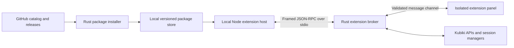

# Proposal: a local extension platform

Status: **Architecture rationale with first implementation**. The initial public
SDK, installer, isolated panels and local runtime are implemented. Redis is kept
in a separate repository; SDK Diagnostics is bundled with Kubiki. The implementation
exposes settings, credentials, notifications and backend calls; Kubernetes APIs,
port-forward integration, remotely refreshed signed catalogs and strict backend
sandboxing remain future work. See [current usage and SDK](EXTENSIONS.md).
Date: 2026-10-23. Owner: Kubiki maintainer. Scope: desktop extension distribution,
runtime, SDK and management interface. This proposal elaborates [the existing
bundled-panel registry](EXTENSIONS.md).

## Context and constraints

Users should discover official extensions in Kubiki and install community
extensions by pasting a GitHub repository URL. Authors should develop independently
of Kubiki's internal React components and Rust implementation. Redis and Kafka
are the initial use cases. No application server, account system or paid marketplace
is required. GitHub provides hosting; installed packages and execution remain local.

Currently `workspace_panels.tsx` supports trusted components bundled with Kubiki.
It has no package installer, external SDK or external runtime. Tauri Rust plugins
are application integration crates; they are not a ready-made repository installer
for end-user extensions. See [Tauri plugin development](https://tauri.app/develop/plugins/).

## Options and recommendation

| Option | Advantages | Costs and limits |
| --- | --- | --- |
| Load external React modules into the main renderer | Smallest prototype; shares components | Couples authors to application internals; exposes the main renderer; cannot by itself implement ordinary Redis/Kafka TCP clients |
| Local Node.js extension host plus isolated panel UI | Familiar TypeScript tooling; existing protocol libraries; independent packages | Adds a bundled runtime, per-platform packaging and process management; trusts installed backend code |
| WASM or restricted JS runtime with brokered I/O | Can support a narrower, enforceable host API | More SDK and networking work; Node libraries cannot generally be reused unchanged |

Recommend the second option for an initial **trusted-extension model**. Start one
host process per active extension, not per installed package or per UI tab. The
observed reasons for the process boundary are external release cadence, protocol
library compatibility and containing extension crashes or event-loop stalls.
Measure actual memory costs before expanding the model. A host crash must leave
Kubernetes tables and other extension hosts operational.

Bundle the Node runtime with the desktop application; do not depend on the user's
Node installation. A regular runtime plus a bootstrap loader is preferable to a
packaging mechanism that prevents loading later-installed modules. Tauri supports
[bundled external executables](https://github.com/tauri-apps/tauri-docs/blob/v2/src/content/docs/develop/sidecar.mdx).

This isolates failures, **not malicious code**. Ordinary Node extensions execute
with the OS user's privileges. Declared capabilities can govern Kubiki's SDK calls,
but do not prevent backend code using its own filesystem or network APIs. VS Code
also documents a trusted extension host with application-level permissions:
[extension runtime security](https://code.visualstudio.com/docs/configure/extensions/extension-runtime-security).
A strict sandbox would require a different runtime boundary or platform-specific
OS isolation; it is a separate requirement, not something a permission dialog supplies.

## Runtime and contracts



The main renderer owns navigation, tabs and the Extensions manager. External panel
code runs in a sandboxed iframe with an isolated origin and a narrow message bridge,
not as an imported component in the main React tree. The existing registry registers
a host-owned adapter for each declared panel. The adapter owns the iframe lifecycle.

Panel assets are served from validated package paths. Apply an explicit CSP, no
direct Tauri IPC, no parent DOM access, and no direct network access in the panel.
Bind its message channel to the installed extension and panel instance in the host;
do not trust an extension ID supplied in a message. Kubiki currently has `csp: null`,
so these boundaries require implementation before enabling downloaded panels.

The backend bootstrap loads the package entry point and provides `activate(context)`
and `deactivate()` lifecycle hooks. Activation is lazy on a contributed view or
command. Multiple tabs can share one extension backend while maintaining separate
view instances. Visibility changes pause view subscriptions; background work needs
an explicit lifecycle. Disable, uninstall, context switch and application exit must
dispose owned subscriptions, connections and port-forward leases.

Use a versioned, typed JSON-RPC contract, runtime message validation, request IDs,
cancellation, deadlines and bounded messages. Streaming APIs need explicit limits
and backpressure. Reserve stdout for protocol traffic and stderr for bounded logs.
Use a private stdio channel rather than exposing a local HTTP server.

The public SDK should initially cover:

- Panel and command contributions, notifications and namespaced settings/storage.
- Theme tokens, interface scale, visibility and connection/context changes.
- Explicit Kubernetes read/watch operations and reviewed mutation intents.
- Owned port-forward leases and namespaced credential storage.
- Typed extension-local backend methods and bounded subscriptions for panel data.

Credentials stay out of workspace tab state. Kubernetes writes via the SDK use the
existing backend confirmation pipeline. An unrestricted Node extension could also
contact Kubernetes itself; the confirmation pipeline is not a system-wide policy
enforcement boundary in this trust model. Redis/Kafka writes need their own
extension operation descriptions; SQL-like arbitrary command APIs are not a
substitute for an understandable review.

Do not export internal Zustand stores, raw Tauri `invoke`, internal component paths
or the full kubeconfig as the SDK. Publish a small UI kit, or bundle compatible UI
components with each isolated panel, and pass host theme tokens through the bridge.

## Package and author template

Define one ZIP-based format, for example `.kubiki-extension`, with a root manifest,
compiled backend, UI assets and license notices. This name and the following schema
are proposed, not supported by the current application:

```json
{
  "manifestVersion": 1,
  "id": "acme.redis",
  "name": "Redis",
  "version": "0.1.0",
  "hostApi": "^1.0.0",
  "runtime": "node",
  "main": "backend/index.cjs",
  "contributes": {
    "panels": [
      { "id": "browser", "title": "Redis", "entry": "ui/index.html" }
    ]
  },
  "requestedCapabilities": ["settings", "credentials", "portForward"]
}
```

Namespace panel, command and storage IDs by extension ID. Version the SDK/host
protocol independently of application patch releases; reject unsupported manifest
versions or host API ranges before activation. Capabilities describe mediated host
access, not a complete inventory of a Node process's possible actions.

An author template should contain `extension.json`, `src/backend.ts`,
`src/ui/App.tsx`, tests, a lockfile, a packaging script and a GitHub release workflow.
The proposed SDK package provides types and test doubles. The development workflow
opens a local development package in a dedicated extension host with logs and reload.
The release workflow builds and uploads the prepared package. Installing it requires
no Git clone, npm install, build tools or package lifecycle scripts on the user's PC.

Start with bundled JavaScript dependencies and static UI assets. Supporting native
Node addons or arbitrary external executables introduces OS/architecture/Node ABI
compatibility and signing requirements; defer those package types until needed.

## Distribution without an application server

Ship an official catalog snapshot with Kubiki. An optional signed static catalog in
the maintainer's GitHub repository can refresh it between app releases. A catalog
entry identifies the extension, description, repository, compatible release and
package digest/signing identity. Built-in packages work offline. Official packages
use the same manifest and SDK as community packages; distribution origin is separate
from package format. The Official badge comes from trusted catalog identity, never
from a boolean in an extension's own manifest.

For repository installation:

1. Parse an HTTPS GitHub repository or release URL and resolve a specific release.
2. Read its package metadata without executing code; choose a compatible artifact.
3. Display repository, resolved version, package identity, compatibility and trust
   model, plus requested Kubiki integrations. A repository without a compatible
   published package gets an actionable error, not an automatic source build.
4. Download the selected artifact into staging with size limits, check its digest
   and any trusted publisher signature, validate the manifest and archive paths,
   then extract under the extension store. Reject traversal, links escaping the
   package, ID collisions and inconsistent metadata. A digest supplied by the same
   untrusted publisher proves byte integrity, not publisher authenticity.
5. Atomically record the installed version and enable it only after the user chooses
   Install & Enable. Retain enough previous-version state to roll back an update.

Public release assets can be downloaded without authentication through the
[GitHub release assets API](https://docs.github.com/en/rest/releases/assets).
Cache catalog/release metadata and handle offline operation and API throttling.
Private repositories and alternative Git hosting providers can follow later through
distribution adapters. A local package installer is useful for offline distribution.

Pin each installation to the exact release and digest; do not execute a moving
default branch. Check for updates separately from applying them. A change of
repository/publisher or additional SDK capabilities requires renewed review.
Immutable GitHub releases can strengthen package provenance, but cannot be assumed
for every repository: [GitHub immutable releases](https://docs.github.com/en/code-security/concepts/supply-chain-security/immutable-releases).

Maintain local installation state independently of remote catalog availability.
Use versioned package directories and an atomic active-version record. On interrupted
download, failed validation or failed activation, keep the previously working
version active. Rollback covers package activation; extension data migrations need
their own compatibility policy or backup, and external Redis/Kafka writes cannot be
undone by rolling back the extension package.

## Extensions manager UX

Use one global Extensions view in the existing IDE shell. Keep the current semantic
colors, typography and scale controls. A compact list with a details pane fits this
product better than a marketing storefront. Collapse details into a single view
on narrow workspaces, preserving search and selection when returning to the list.

The header contains search and an Install from GitHub action. Sections are Catalog,
Installed and Updates, with a visible Built-in/Official/Community origin label.
Each item shows name, author/source, short description, version and its current
state. Useful actions are Install, Open, Enable/Disable, Update, Roll Back,
Uninstall and View Logs. Built-ins expose Disable rather than an uninstall action
that cannot remove bytes bundled with the app.

The GitHub form has a visible URL label and a Check button. Preview metadata before
installation. Report stages such as Downloading, Validating and Installing; provide
Cancel while cancellation is still safe, and show retry or corrective guidance
beside failures. Avoid a single spinner covering the entire view. Errors and
completion use accessible status announcements. All actions support keyboard
navigation and visible focus; long names, URLs and permission descriptions wrap.

Installed packages distinguish enabled/disabled from activating/running/failed;
being installed does not imply a live process. A crashed extension shows Restart
and View Logs without taking over the whole workspace. Its existing tabs retain
an explicit unavailable state until recovery. Removing an extension removes its
navigation contributions, not unrelated workspace tabs or saved connections.

Use a compact management control to pin extension panels to the activity bar; do
not require every installed package to add a permanent icon.

## Delivery sequence and validation

1. Specify and test the manifest, contribution registry, SDK lifecycle and a tiny
   example extension. The example must build outside the Kubiki repository.
2. Implement local package staging/validation, installation records and rollback;
   add the Extensions manager with built-in packages and local installation.
3. Implement the bundled Node host, isolated panel bridge, failure handling and
   owned-resource cleanup. Verify packaging on Linux, macOS and Windows before
   selecting it as a supported public runtime.
4. Add GitHub Releases resolution and the static official catalog. Test offline,
   incompatible, interrupted, malformed and changed-source cases.
5. Implement Redis as the first complete SDK consumer, then Kafka to expose API
   gaps. Publish the author template and compatibility policy with those examples.

Release gates: a community example installs from a public release on a clean machine
without Node/npm; core Kubernetes views remain usable if an extension crashes or
hangs; disable/uninstall release owned resources; malformed packages cannot escape
their installation directory; an interrupted update preserves the working version;
previously installed extensions open without GitHub availability.

Before committing to this runtime, measure application size and memory with zero,
one and two active extensions. Falsify the choice if the supported clients cannot
run from packaged JS dependencies on all target platforms, or its measured runtime
cost exceeds the maintainer's desktop budget. Revisit a restricted runtime if
enforced isolation from malicious installed code becomes a product requirement.

## Comparable systems and patterns

VS Code separates the manifest, contribution points, lazy activation, extension
host and custom webviews. Desktop hosts can use Node.js while web hosts use browser
workers. Packages can be installed as VSIX without marketplace publication:
[manifest](https://code.visualstudio.com/api/references/extension-manifest),
[activation](https://code.visualstudio.com/api/references/activation-events),
[extension hosts](https://code.visualstudio.com/api/advanced-topics/extension-host),
[webviews](https://code.visualstudio.com/api/extension-guides/webview),
[VSIX installation](https://code.visualstudio.com/docs/configure/extensions/extension-marketplace#_install-from-a-vsix).

IntelliJ uses declared extension points and implementations in `plugin.xml`:
[IntelliJ extensions](https://plugins.jetbrains.com/docs/intellij/plugin-extensions.html).
Lens exposes interface and Kubernetes integration points through extension features;
its documented module sandbox is not a runtime permission boundary:
[Lens extensions](https://docs.lenshq.io/k8slens/extensions/).

The reusable patterns are a microkernel with explicit extension points, Registry
for contributions, Ports and Adapters for the SDK and package sources, RPC/Proxy
across runtime boundaries, State Machine for installation and execution, and
Disposable/ownership for resource cleanup. There is no universal manifest that
makes VS Code, IntelliJ, Lens and Kubiki extensions interchangeable.
