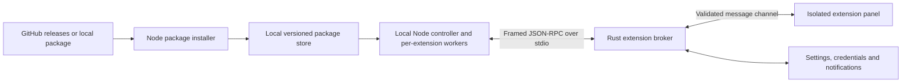

# Extension runtime architecture

See [Workspace extensions](EXTENSIONS.md) for installation, package format and
SDK usage. SDK Diagnostics is bundled; Redis and Kafka are separate projects.

The runtime uses a bundled Node.js controller and one worker per active extension.
Workers are shared across that extension's tabs. Rust brokers requests between the
controller and isolated frontend panels. Extension packages do not import Kubiki's
internal React components or Zustand stores.

The reasons for this boundary, alternatives and costs are recorded in
[ADR-011](decisions/011-trusted-node-extension-runtime.md).

## Runtime and contracts

The main renderer owns navigation, tabs and the Extensions manager. External panel
code runs in a sandboxed iframe with an isolated origin and a narrow message bridge,
not as an imported component in the main React tree. The existing registry registers
a host-owned adapter for each declared panel. The adapter owns the iframe lifecycle.

Panel assets are loaded from validated package paths. Each panel has an explicit
CSP and no direct Tauri IPC, parent DOM access or direct network access.
The host binds its message channel to the installed extension and panel instance.
`ExtensionPanel.tsx` inserts a panel-specific CSP into the iframe document, including
`connect-src 'none'`, and uses an opaque origin. Node backends remain trusted code
with the user's OS privileges.

The backend bootstrap loads the package entry point and provides `activate(context)`
and `deactivate()` lifecycle hooks. Activation is lazy on a contributed view or
command. Multiple tabs can share one extension backend while maintaining separate
view instances. Panels receive visibility events and should pause their background
work when hidden. Disable, last-view close, uninstall and application shutdown
dispose the extension's owned connections/subscriptions with a deadline. A
Kubernetes context-change or port-forward lease lifecycle is not a current SDK API.

The host uses a versioned JSON-RPC contract with runtime validation, request IDs,
cancellation, deadlines and bounded messages over private stdio. Stdout carries
protocol traffic and stderr carries bounded logs.

Host API 1.0 currently covers panel and command contributions, namespaced settings,
OS credential storage through the `secrets` capability, notifications, host theme
tokens/interface scale, panel visibility and JSON calls to the extension's own
backend with cancellation. It does not expose Kubernetes reads/watches, reviewed
cluster mutations, cluster-context subscriptions or port-forward leases. Those are
possible future contracts, not capabilities accepted by the current manifest.

Credentials stay out of workspace tab state. Node backends are trusted local code
and can perform network and filesystem operations with the user's privileges.
The panel bridge does not sandbox the backend or enforce system-wide Kubernetes
permissions. Only install extensions you trust.
