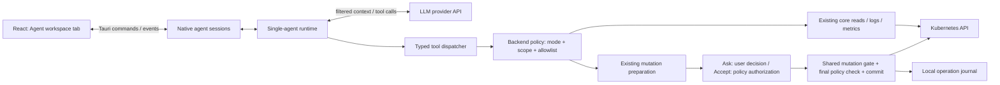

# 002: Integrated Kubernetes agent and execution modes

Статус: **принято для первого этапа**, с уточнениями реализации ниже.
Дата: 2026-10-30. Предлагаемый владелец: сопровождающие Kubiki desktop/core.
Заменяет: —. При пересмотре связать новое ADR с этим документом.

Уточнено [ADR-003](003-shared-kubernetes-access-and-ai-phases.md): общий Kubernetes
access service, независимые Plan / Action и новые приоритеты. Актуальный порядок
дальнейшей разработки — [AI roadmap](../AI_ROADMAP.md); создание/deployment последними.

## Уточнения первого этапа

Пользователь подтвердил начало разработки и выделение AI в отдельную доменную
область. Реализованы отдельный `crates/kubiki-ai` и frontend-домен
`src/domains/ai`, четыре provider-протокола с динамическими моделями, отдельный
чат, resource actions и backend policy для трёх режимов. Вместо SQLite первый
этап использует журнал метаданных JSONL без сохранения переписки; нет потребности
в запросах к истории, оправдывающей новую DB-зависимость. Стартовые default
write permissions выключены. Отдельный cloud runtime не добавлен.

Ниже сохранён исходный архитектурный анализ, включая последующие этапы и
предлагаемые метрики. Актуальные возможности, ограничения, детали журналирования
и команды проверки описаны в [Integrated AI agent](../AI_AGENT.md).

## Контекст и рекомендация

Нужен встроенный агент с отдельной вкладкой и режимами `read only`, `ask`,
`accept`. Начальный режим — `read only`. Ни модель, ни её текстовый ответ
не должны определять, разрешена ли операция.

Рекомендация: **собственный небольшой Kubernetes agent runtime внутри Rust
backend Kubiki, готовые модели через API, общие типизированные инструменты
и отдельная backend policy**. «Свой агент» здесь означает управление циклом
модель → инструмент → результат, а не обучение модели. Начать с одного
провайдера — OpenAI Responses API с function calling; контракт провайдера
позволяет позднее добавить Anthropic Messages или проверенный локальный backend.
Совместимость произвольного «OpenAI-compatible» endpoint не предполагать.

Выбор обусловлен главным требованием: режимы исполнения важнее повторного
использования универсального coding harness. Это рекомендация по архитектуре,
а не результат измеренного сравнения качества моделей.

Предположения: приложение остаётся локальным desktop-продуктом; допустима
настройка API credentials; первая версия выполняет задачи по запросу пользователя,
без фонового автолечения. Если обязательна работа через существующий аккаунт
установленного CLI, приоритет варианта с внешним runtime повышается.

## Что уже есть в Kubiki

Проверены исходники, а не только README:

| Область | Текущее состояние и применение |
| --- | --- |
| UI | React/TypeScript, Zustand, Tauri 2. Реестр `src/core/workspace_panels.tsx` подходит для встроенной панели агента и навигации через activity bar. |
| Существующий AI | `src/core/ai_analysis.ts` строит ограниченный снимок; `AnalysisView.tsx` показывает prompt и терминал; `host_terminal.rs` запускает Codex/OpenCode/Claude Code. Это объяснение снимка, а не агент с инструментами Kubiki. |
| Чтение кластера | `kubiki-core`: context-specific clients, reads, discovery, metrics, logs. Можно переиспользовать без обязательного `kubectl`. |
| Изменения | `mutation_commands.rs` преобразует структурированные intent в `PreparedMutation` / `PreparedBatch` / `PreparedHelmMutation`. Подготовка, подтверждение и commit уже разделены. |
| Контроль изменений | `MutationGuard` сериализует изменения и установку обновлений. Core проверяет identity и optimistic concurrency; групповые операции выполняются последовательно и не являются транзакцией. |
| Подтверждение | Текущий desktop-путь всегда запрашивает пользователя. В core consent передаётся через backend callback; это удобный шов для policy, но готового режима `accept` сейчас нет. |
| Расширения | Публичный SDK даёт settings/secrets/notifications, без Kubernetes tool API. Node backend расширения является доверенным локальным кодом. Для основной гарантии режимов внешний extension — неподходящая граница. |

Текущий Codex запускается с filesystem sandbox `read-only`; это само по себе
не доказывает запрет Kubernetes writes. Для интегрированного агента нужны
собственные ограничения инструментов. Старый Analyze не считать эквивалентом
нового режима до проверки каждого CLI и его пользовательской конфигурации.

## Варианты

| Подход | Плюсы | Минусы | Вывод |
| --- | --- | --- | --- |
| Запуск внешнего CLI в терминале | Уже частично реализован; маленький объём интеграции; пользователь сохраняет привычную настройку CLI | Терминальный UX; трудно связать операции с карточками ресурсов; разные permissions/config; доступ к shell или kubeconfig может обойти policy Kubiki | Сохранить как существующий отдельный сценарий анализа снимка; не делать основой новой функции |
| Готовый runtime под собственным UI | Готовые сессии, управление контекстом и события; доступны Codex app-server, Claude Agent SDK, OpenCode server/SDK | Версии и контракты внешнего процесса; встроенные tools и пользовательские MCP/plugins; отдельная проверка изоляции на каждой ОС; несовпадение approvals coding tools с Kubernetes intent | Жизнеспособно при приоритете конкретного harness/account; отдельный адаптер после проверки изоляции |
| Собственный узкий runtime + LLM API | Единая семантика режимов; только инструменты Kubiki; прямые backend receipts; отсутствие agent shell; проще контролировать scope и передаваемые данные | Нужно реализовать streaming, tool loop, отмену, бюджеты, историю/сжатие контекста и provider errors; настройка API credentials | Рекомендуемый основной путь |

Вариант с готовым runtime тоже требует собственных policy, tools, аудита и UI.
Он экономит разработку управления агентом, но не устраняет основной объём
работы по интеграции с Kubernetes. Ни один вариант не гарантирует меньшую
стоимость или лучшее качество диагностики без сравнения на одних задачах.

### Что полезно взять из Radar

В [Radar](https://github.com/skyhook-io/radar/blob/main/docs/configuration.md#ai-investigations-agent-cli)
встроенные расследования используют установленные Claude Code, Codex, Cursor
или OpenCode. Доступ к данным предоставляет собственный MCP server.
В [документации MCP](https://github.com/skyhook-io/radar/blob/main/docs/mcp.md)
для OpenCode описан профиль с пользовательской конфигурацией без CLI sandbox:
диагностика использует read-only MCP, подтверждённый Apply — отдельную сессию
с записью, затем идёт проверка состояния. Документация отмечает ограничения
доверия к результатам записи в таком профиле.

Вывод для Kubiki: полезны подготовленные диагностические данные, отделение
диагноза от исполнения и проверка результата. Один read-only MCP endpoint
не изолирует остальные capabilities внешнего агента.

### Конкретные внешние runtime

- [Codex app-server](https://learn.chatgpt.com/docs/app-server): предназначен для
  встроенных клиентов, предоставляет threads, streaming и approvals через
  JSON-RPC. Перспективный первый внешний адаптер. `dynamicTools` на дату
  проверки отмечены experimental: не делать их обязательной основой policy.
- [Claude Agent SDK](https://code.claude.com/docs/en/agent-sdk/overview): готовый
  loop, tools и context management для TypeScript/Python; добавляет agent
  binary/runtime. Документация отдельно ограничивает предоставление claude.ai
  login/лимитов в сторонних продуктах без предварительного разрешения;
  нельзя обещать перенос подписки в SDK-интеграцию.
- [OpenCode SDK](https://opencode.ai/docs/sdk/): типизированный JS/TS-клиент
  server runtime с sessions/events. Гибок для провайдеров, но требует процесса
  сервера и контроля загружаемой конфигурации.

Для внешнего runtime обязательны проверенные запреты built-in shell, filesystem,
произвольной сети и посторонних MCP/plugins; минимальная конфигурация и только
brokered tools Kubiki. Удаление `KUBECONFIG` из environment не является
изоляцией: остаются default kubeconfig, cloud credentials и другие пути доступа.
Если нельзя доказать ограничения на поддерживаемой ОС, не выдавать такую
интеграцию за исполнителя с гарантированными режимами Kubiki.

## Семантика режимов

Здесь `accept` трактуется как автоматическое исполнение **разрешённых policy
изменений**. Это не кнопка однократного принятия ответа модели.

| Действие агента | Read only — default | Ask | Accept |
| --- | --- | --- | --- |
| Разрешённые чтения, события, ограниченные логи/метрики | Автоматически | Автоматически | Автоматически |
| Подготовка предложения и локального diff без побочных эффектов | Да | Да | Да |
| Разрешённая мутация | Запрещена | Конкретный prepared intent/diff → решение пользователя → commit | Автоматически после всех проверок policy и preconditions |
| Операция вне scope/allowlist, неизвестный tool | Запрещена | Запрещена | Запрещена |
| Изменение режима, расширение scope, самоодобрение | Только пользователь | Только пользователь | Только пользователь |

У `accept` нет скрытого дополнительного подтверждения для операции,
включённой в allowlist. Ограничения типов ресурсов, количества объектов и
диапазона scale — отдельная явно видимая policy, одинаковая для всех режимов.
RBAC и admission Kubernetes продолжают применяться.

- Режим хранится в backend session. Новый разговор и восстановленная сессия
  после рестарта начинают с `read only`; сохранять `accept` как глобальный
  default нельзя. Скрытие вкладки само по себе режим не меняет.
- Scope фиксирует connection/context revision, namespaces и при необходимости
  конкретные resource UID. Изменение общего cluster selector не перенаправляет
  уже начатый разговор. Перепривязка — явное действие с отменой текущего run
  и сбросом в `read only`.
- Policy имеет revision. Downgrade/Stop инвалидируют ещё не отправленные
  изменения и pending approvals. Повышение режима не запускает старые
  заблокированные intent автоматически.
- Проверка режима и допуск commit сериализуются с изменением policy. Для batch
  допуск проверяется перед каждым шагом. Запрос, уже отправленный в Kubernetes,
  может завершиться после Stop/downgrade; UI должен показать этот факт.
- Approval привязан к owner window, session/run/tool call, scope revision,
  точным prepared arguments/diff и UID/resourceVersion. Он одноразовый,
  не переносится на изменённый план. Ожидание не означает согласие и не
  превращается в auto-accept по таймеру.
- Агент не получает tools для вызова UI approval IPC, смены policy, открытия
  терминала или передачи работы расширению с более широкими правами.

Read only относится к возможностям агента. Обычные ручные действия Kubiki
сохраняют существующий механизм подтверждения.

## Топология и границы

Один репозиторий, существующий Tauri/Rust процесс, без отдельного cloud backend.
AI — логический модуль модульного монолита. Давления для отдельного сервиса
(независимые релизы, ownership, масштабирование) сейчас не наблюдается.
Первый эксперимент: один активный run с ограниченными reads не должен ухудшать
отклик обычных вкладок относительно замера без AI. Измеренная проблема
устраняется бюджетами/concurrency до рассмотрения нового процесса.

Предлагаемое размещение:

- `crates/kubiki-core/src/agent/`: session types, runtime, provider adapter,
  tool schemas, policy и bounded evidence projections; без зависимости от Tauri.
- `src-tauri/src/agent_commands.rs`: window ownership, user-only control commands,
  событийный канал, lifecycle и композиция с `MutationGuard`/consent UI.
- `src/views/AgentView.tsx`, `src/state/agent_store.ts`,
  `src/providers/agent.ts`: представление native state и UI событий.
- Общий backend mutation executor используется ручными командами и агентом;
  ручной origin всегда требует текущего UI consent, agent origin читает
  backend policy. Origin/authorization не принимаются как доверенные поля
  произвольного mutation IPC.

Конкретные технологии: существующие Rust/Tokio/serde/kube, `reqwest` для
provider HTTP streaming; JSON Schema для tools; Tauri Channel для событий;
SQLite через `rusqlite` для журнала операций; существующий `keyring` для API
ключей. Версии новых зависимостей выбирать при реализации под текущий lockfile.
SQLite добавляет локальную зависимость, не новый deployable. Блокирующие
операции SQLite выполнять вне async executor threads.

Для первого backend использовать
[Responses function calling](https://developers.openai.com/api/docs/guides/function-calling):
модель возвращает запрос инструмента, приложение проверяет его и исполняет
собственный код. API keys доступны только native backend; WebView получает
состояние «настроено» и безопасные метаданные. Отдельно выбрать и проверить
модель на диагностическом наборе, не фиксировать vendor model ID в policy.

MCP в первой версии не нужен. При появлении запроса на внешних клиентов
добавить адаптер над тем же dispatcher/policy; MCP не заменяет исполнение policy.
[Tool annotations](https://modelcontextprotocol.io/specification/2025-11-25/schema#toolannotations)
являются hints, а не гарантией поведения.

## Tools, данные и доверие

Первый набор reads: `list_resources`, `get_resource`, `get_events`,
`get_logs`, `get_metrics`. Ответ содержит identity, источник, capturedAt,
покрытие, truncation и ошибки. Диагностика строится из ограниченных данных,
а не из полного дампа кластера. Не создавать отдельные широкие informers:
переиспользовать core, demand-driven reads и лимиты. Для live reads не требовать,
чтобы нужная коллекция уже была загружена во frontend.

Примеры write tools: `scale_workload`, `restart_workload`; позднее — проверенный
manifest update. Начальный allowlist ограничить workload actions и явными
namespace/resource boundaries. Произвольные shell/HTTP/exec, Secret values,
RBAC changes, debug Pods, drain и Helm hooks не входят в первый набор.
Добавлять их отдельными изменениями policy с тестами и оценкой последствий.

`propose_change` может возвращать план/локальный diff без исполнения.
`execute_change` проходит через native preparation и authorization; текст
«пользователь уже согласился» в аргументах ничего не разрешает.
[Server dry-run Kubernetes](https://kubernetes.io/docs/reference/using-api/api-concepts/#dry-run)
не сохраняет объект, но требует тех же прав, что обычная запись. Для однозначной
семантики V1 в `read only` использовать локальный preview; серверную валидацию
добавлять отдельным разрешённым capability.

Существующая диагностика/топология частично реализована в TypeScript.
Не считать frontend cache полным или авторитетным состоянием и не переносить
весь UI graph engine в Rust ради MVP. Начать с core reads и простых связей
ownerReferences/selectors; richer diagnostic projections добавлять явно.

Secret data/stringData, kubeconfig, credentials, прямые env values и произвольные
annotations не передаются по умолчанию. Для CRD необходима allowlist projection:
секреты бывают в произвольных полях, а не только в объектах Secret. Logs,
Events и ConfigMaps также могут содержать чувствительный текст; redaction
по шаблонам не даёт полной гарантии. Состав передаваемых данных и провайдер
должны быть видимы пользователю, отключение отправки логов — отдельная настройка.
Режим записи не расширяет доступ к чувствительным данным.

Prompt injection из logs/events/resource fields рассматривается как недоверенный
ввод. Защита не зависит только от system prompt: модель не имеет capabilities
обхода tool dispatcher. Человекочитаемый итог не является подтверждением записи.

## Вкладка и сессии

Встроенная панель **AI Agent** регистрируется через существующий workspace
registry; внешнее расширение и iframe для неё не требуются. У панели собственный
список разговоров; сама вкладка поддерживает существующий split view.

Верхняя строка: закреплённый context/namespaces, provider/model,
`Read only | Ask | Accept`, Stop. В разговоре — сообщения, evidence-ссылки
на ресурсы, вызовы инструментов, карточки prepared changes и backend receipts.
В `ask` использовать существующий native consent path с привязкой к разговору;
для AI показывать точные параметры изменения и diff, когда он применим.
Глобальный modal допустим для первой версии, хотя блокирует параллельные review.

`Analyze` из ресурса должен создавать разговор с ограниченным диагностическим
snapshot и ссылкой на ресурс. Существующий terminal Analyze сохраняется до
проверки замены и обозначается как отдельный сценарий, со своими ограничениями.
Закрытие вкладки явно останавливает её run; скрытие при навигации — нет.
В browser/demo нет настоящих writes/provider calls; возможны fixtures и preview.

## Состояние, отказы и эксплуатация

Backend — источник истины по mode/scope/pending actions. Состояния run:
`idle → running → awaiting_approval → executing → verifying → completed`,
а также `failed`, `cancelled`, `uncertain`. UI восстанавливает состояние по
session ID и sequence событий, а не запускает повторную запись при remount.

SQLite хранит метаданные session и журнал: operation ID, owner/session,
scope/policy revision, target identity, параметры разрешённой структурированной
операции либо digest manifest, authorization, dispatch status и receipt.
Запись намерения фиксируется до отправки мутации; если журнал недоступен,
запись не отправляется. Token/Secret data и полные tool outputs не журналировать.
Тексты разговоров в V1 остаются в памяти; долговременную историю и её retention
спроектировать отдельно. Журнал локальный, не tamper-proof compliance audit.

По operation ID повторно выдаётся существующий статус; этот механизм не
обеспечивает exactly-once Kubernetes write. Crash между dispatch и receipt
даёт `uncertain`, read-back и ручное решение. Автоматический replay запрещён.
API acceptance, rollout completion и подтверждённое достижение цели — разные
результаты. При отсутствии наблюдаемого критерия проверки нельзя писать «исправлено».

Начальные бюджеты для проверки прототипом: один активный run на разговор,
не больше двух разговоров одновременно, до четырёх read requests суммарно,
до 20 tool calls на run, 15 s для обычного read, 60 s без событий от provider.
Логи ограничены временем/строками и общим размером ответа. Достигнутый лимит
останавливает run с объяснением. Usage/tokens показывать по данным провайдера;
не выдавать приблизительную оценку за точную стоимость.

Read-only retries — ограниченные, с backoff и jitter. Write timeout, disconnect
после dispatch и частичный batch не повторяются автоматически. Provider outage
останавливает AI, но обычные Kubernetes views работают. Pending approval не
блокирует чтения; текущий общий mutation gate сохраняет взаимное исключение
с ручными writes и установкой обновления. Закрытие окна отменяет session tasks
и pending approvals; уже принятый API запрос не считается отменённым.

Владельцы desktop/core сопровождают runtime, tool policy и журнал; frontend
владельцы — UI и event contract. Релиз и incident boundary остаются у Kubiki,
provider outage — внешняя зависимость. При появлении CODEOWNERS закрепить
эти пути и требовать core review для расширения agent capabilities. Отдельная
команда/on-call для AI сервиса сейчас не обоснована.

## Внедрение и проверка

1. Зафиксировать контракт mode/scope/authorization, вынести общую композицию
   mutation execution, сохранив текущий ручной consent. Добавить backend tests
   запретов и гонок до подключения реальной модели.
2. Под feature flag добавить вкладку, один provider и только reads. Подключить
   resource Analyze. Проверить streaming, отмену, данные и бюджет.
3. Добавить `ask` для ограниченного набора scale/restart: native preparation,
   точный review, одноразовое approval, receipt и read-back.
4. Добавить `accept` на том же executor после adversarial tests и проверки
   downgrade/Stop. Затем расширять tools; внешний runtime/MCP — отдельный этап.

До появления write stages переключатель показывает недоступные режимы явно,
не имитирует их поведение. Это последовательность разработки, не финальный
объём функции: конечное требование включает все три режима.

Ключевые проверки: write tool в read-only; неизвестный tool; смена scope/context;
изменение объекта после review; повтор approval; подмена owner/session;
поддельное согласие в prompt; downgrade во время ожидания и между batch steps;
Stop до/после dispatch; provider disconnect; application crash и unknown outcome;
инъекции из логов; утечки в projections. Интеграционные проверки выполняются
на отдельном тестовом кластере, включая RBAC deny и admission reject.

Feature flag отключает новые agent sessions; для уже начатых run backend
отзывает ещё не отправленные writes. Старый Analyze и ручные операции дают
обратимый путь UI rollout. Schema journal — additive/versioned; откат приложения
не replay-ит записи. Откат AI функции не отменяет применённые кластерные изменения:
компенсация требует отдельного reviewed intent, универсального Undo нет.

Предлагаемые цели, **не измеренные характеристики проекта**:

- 0 отправленных мутаций в `read only`, 0 writes без approval в `ask`,
  0 writes вне scope/allowlist во всех режимах.
- 100% dispatch имеют журнал; каждый неоднозначный результат отображается как
  `uncertain`, а не success. Локальная реакция Stop — p95 < 1 s; завершение
  уже отправленного Kubernetes запроса в этот показатель не входит.
- Зафиксировать baseline времени ручного расследования и сравнить с AI на
  20 сценариях: CrashLoopBackOff, Pending, OOM, image pull, selector mismatch
  и т. п. Считать диагностическую точность, полноту evidence, ложные «исправлено»,
  время, tokens и стоимость; отдельно оценить варианты runtime.
- Замерить отклик обычных вкладок без AI и под ограниченной нагрузкой AI;
  отсутствие регрессии оценивать на том же кластере и машине.
- DORA измерять для desktop-релизов относительно собственного baseline:
  deployment frequency, change lead time, failed deployment recovery time,
  change fail rate, deployment rework rate. Не вводить отдельный «AI deployment»
  при общем runtime и не назначать числовые цели без исходных измерений.

## Отложенный объём и условия пересмотра

Пока не нужны multi-agent orchestration, vector DB/RAG, удалённый AI service,
плагины агента, общий shell, автоматическое фоновое исправление и универсальный
набор write tools. Самостоятельный runtime означает реальную поддержку
streaming/tool protocol и контекста; этот объём нужно оценить на прототипе.

Пересмотреть выбор, если настройка API credentials блокирует основной сценарий,
готовый harness существенно превосходит узкий loop на одном evaluation set или
сопровождение provider protocol становится дороже изоляции внешнего runtime.
Проверяемый spike в таком случае — один Codex app-server adapter с тем же tool
dispatcher, попытками обхода policy и сравнением UX/качества/стоимости.
Без успешной проверки изоляции не заменять основной runtime внешним агентом.
