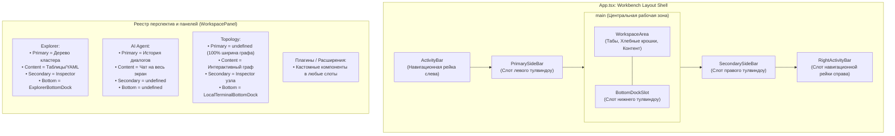

# 004: Универсальный шаблон макета (Workbench Layout Shell) и подключаемые слоты панелей

Дата: 2026-10-31. Статус: **принято и реализовано**.
Владелец: сопровождающие Kubiki desktop/UI.

---

## 1. Контекст

Ранее интерфейс приложения Kubiki имел жесткий монолитный каркас:
- `App.tsx` напрямую монтировал `Sidebar` (дерево ресурсов кластера) слева, глобальный `BottomDock` (терминал, логи) внизу и `InspectorPanel` справа.
- В нижней части экрана `BottomDock` занимал пространство на одном уровне с основным контентом, но залезал под новые интерфейсы (например, AI Agent), а на вкладках, где терминал не нужен, необоснованно съедал половину полезной площади экрана.
- Вкладка топологии (`TopologyView`) при открытии получала левый сайдбар, сжимавший холст интерактивного графа, хотя топологии требовался весь экран по ширине.
- Правая панель была захардкожена исключительно под инспектор ресурсов Kubernetes и не могла использоваться другими перспективами.
- Попытка регулировать поведение нижней панели через внутренние флаги режимов (`mode: 'full' | 'local' | 'none'`) привела к антипаттерну «протекающей абстракции» (leaky abstraction): внутри одного компонента разрослись тернарные операторы, ветвления и смешение логики кластерных логов с локальной консолью.

Требовалось создать гибкий шаблон рабочего пространства (**Workbench Layout Shell**), в котором любая перспектива (вкладка) натягивает на каркас собственные интерфейсы без изменения глобальной разметки.

---

## 2. Архитектурное решение

В основу архитектуры положен паттерн **Workbench Tool Window Shell** (аналогично JetBrains New UI и VS Code Workbench):



### 2.1. Симметричные слоты в контракте `WorkspacePanel`

Интерфейс `WorkspacePanel` в [src/core/workspace_panels.tsx](file:///home/yarick/my/myproject/kubiki/src/core/workspace_panels.tsx) стандартизирован и предоставляет три симметричных слота:

```typescript
export interface WorkspacePanel {
  id: string;
  title: string;
  icon: LucideIcon;
  component: ComponentType<WorkspacePanelProps>;
  sidebarComponent?: ComponentType;          // Левый тулвиндоу (Primary Side Bar)
  secondarySidebarComponent?: ComponentType; // Правый тулвиндоу (Secondary Side Bar)
  bottomPanelComponent?: ComponentType;      // Нижний тулвиндоу (Bottom Panel)
  context: 'global' | 'cluster';
  tabType?: WorkspaceTab['type'];
  open?: () => void;
}
```

### 2.2. Разделение слотов хоста и контентных компонентов

1. **Хосты тулвиндоу (Tool Window Hosts)**:
   - `PrimarySideBar`: управляет вертикальным ресайзом слева, сохранением ширины `sidebarWidth`, оверлеем в узких вьюпортах и скрытием/монтированием левых панелей.
   - `SecondarySideBar`: управляет вертикальным ресайзом справа, шириной `inspectorWidth`, отступом от шапки и отображением инспекторов или кастомных правых панелей.
   - `BottomDockSlot`: располагается строго внутри тега `<main>` между контентом и статус-баром (никогда не залезает под левый/правый сайдбар). Управляет горизонтальным ресайзом высоты `dockHeight`, состоянием `dockCollapsed` и монтирует зарегистрированный `bottomPanelComponent`.
   - Если у активной перспективы слот равен `undefined`, соответствующий хост возвращает `null` (в DOM не генерируется обертка, ресайзер и слушатели событий).

2. **Изолированные контентные компоненты (без флагов режимов)**:
   - `BottomDock`: чистый кластерный компонент для Explorer (логи подов, консоли контейнеров, debug shell нод, проброс портов, события кластера, локальный терминал).
   - `LocalTerminalBottomDock`: легковесный компонент исключительно для локального терминала хоста (используется на вкладке Topology и других специализированных вкладках).
   - `AiConversationsSidebar`: вынесенный из тела чата левый сайдбар истории бесед и настроек AI.

### 2.3. Поведение глобальных навигационных элементов

- **Activity Bar (слева и справа)**:
  - Левая и правая рейки остаются сквозными и стабильными между вкладками.
  - Кнопка вызова нижней панели в рейке (`Terminal`) и хоткей `⌘J` проверяют предикат:
    ```typescript
    export function hasBottomPanel(area: string, panels: readonly WorkspacePanel[]): boolean {
      if (area === 'explorer') return true;
      return panels.some((p) => p.id === area && !!p.bottomPanelComponent);
    }
    ```
  - На вкладках без нижней панели (например, AI Agent) кнопка отключается (`disabled`), тултип предупреждает о недоступности в данной вкладке, а шорткат `⌘J` игнорируется.

---

## 3. Последствия и преимущества

1. **Масштабируемость**: Добавление новых перспектив (например, трассировщик сети, тестовый раннер, аналитика метрик) сводится к регистрации объекта `WorkspacePanel` со своими компонентами в слотах. Код макета `App.tsx` больше не меняется.
2. **Чистота архитектуры**: Полностью устранены искусственные типы вроде `AreaDockMode = 'full' | 'local' | 'none'` и условные операторы внутри компонентов.
3. **Геометрическая корректность**: Терминал и нижние панели больше физически не могут перекрыть сайдбары или выползти за пределы контентной области.
4. **Сохранение контекста**: Первичные панели (дерево кластера с поисковым фильтром) сохраняют своё DOM-состояние при переключении вкладок через атрибут `hidden`, исключая сброс поисковой строки или развернутых веток.
5. **Тестируемость**: Все компоненты слотов автономны и покрыты как unit-тестами, так и сквозными E2E тестами в Playwright.
