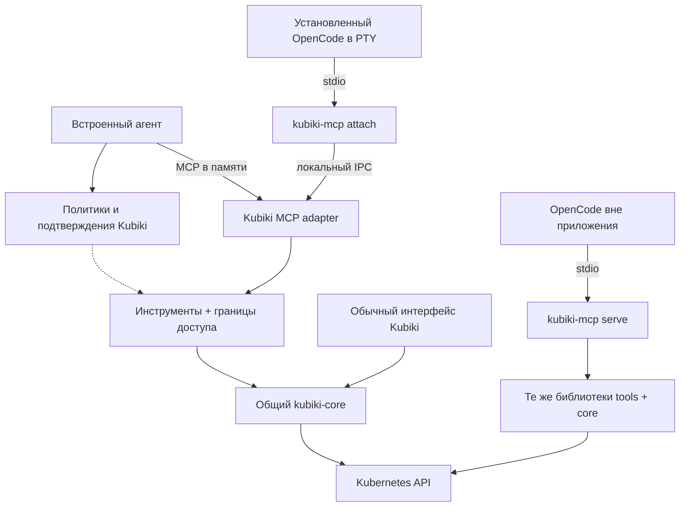

# 007: Переносимый модуль инструментов кластера и OpenCode внутри Kubiki

> Implementation update: portable tools, embedded MCP, attached external CLIs and
> standalone stdio serve exist. This record preserves the extraction design and
> migration sequence. Current commands and boundaries: [AI agent](../AI_AGENT.md).
> Model-facing structured plans are superseded by [ADR-010](010-conversational-markdown-plans.md).

Дата: 2026-11-01. Статус: **принято; реализация и проверки выполняются**.
Владелец: сопровождающие Kubiki core/desktop; отдельная сервисная команда не нужна.
Уточняет [ADR-002](002-integrated-ai-agent.md), [ADR-003](003-shared-kubernetes-access-and-ai-phases.md)
и [ADR-006](006-reviewed-ai-plans-and-transcript-history.md). После реализации заменяет
решение не выпускать самостоятельный MCP и размещение agent execution в Tauri.
Общие Kubernetes-операции, ограничения данных и проверка принятых изменений сохраняются.
Уточнение по запросу пользователя: выбор runtime находится только в настройках,
по умолчанию Kubiki; при выборе OpenCode он владеет permissions и подтверждениями.

## Цель и границы

Встроенный агент специализируется на Kubiki и Kubernetes. Произвольные внешние MCP
и общий локальный shell из его инструментов убираются. Пользователь может выбрать
свой установленный OpenCode внутри окна приложения или использовать инструменты
Kubiki через MCP вообще без установленного desktop.

MCP предоставляет инструменты и контекст. Модель, reasoning loop, провайдеры,
история разговора и интерфейс принадлежат выбранному агенту. В режиме Kubiki
разрешениями и подтверждениями управляет модуль Kubiki. В режиме OpenCode
permissions и подтверждения принадлежат OpenCode. MCP в обоих случаях отвечает
за доступные capabilities, границы подключения, выдаваемые данные, корректность
операций и проверку результата.

Один репозиторий, Rust/Tokio/kube, официальный Rust MCP SDK `rmcp`, Tauri/React,
существующие `portable-pty` и `@xterm/xterm`. Внешний daemon, облачный сервис,
микросервисы, очередь сообщений и отдельная БД политик не нужны.

## Что подтверждено в текущем коде

- `kubiki-core` уже headless: подключения, чтения, mutations, PTY доступны без Tauri.
- `src-tauri/src/agent_tools.rs` зависит от `WebviewWindow`, window state,
  `MutationGuard`, подтверждений и lifecycle desktop. Просто экспортировать этот
  файл как MCP нельзя.
- `kubiki-ai` сейчас смешивает provider/runtime с policy, query, diagnostics,
  plans/execution и добавленной универсальной environment-средой.
- `HostTerminalManager` уже умеет PTY, resize, streaming, acknowledgement и stop,
  но принимает только разрешённый shell. Запуск конкретного executable с argv,
  cwd и ограниченными добавлениями env нужно выделить отдельно.
- Локально найден `/usr/local/bin/opencode`, `opencode --version` → `v2.0.27`.
  `--help` подтверждает `--standalone`, `--session` и `--prompt`.
  Проверена справка; реальные MCP permissions и Plan этой версии ещё не проверены.

## Блоки и зависимости

| Блок | Ответственность | Чего в нём нет |
| --- | --- | --- |
| `kubiki-core` | Kubernetes access, connection generation, read budgets, prepare/dispatch mutations | LLM, MCP, UI |
| `kubiki-tools` — новая библиотека | Каталог операций, scope/projection, reviewed operations, receipts/verification; Kubiki policy и approvals подключаются по режиму | Tauri, provider protocols, произвольный shell |
| `kubiki-mcp` — новая библиотека + CLI | MCP schemas/dispatch, resources, stdio, адаптер подключения к desktop, привязка владельца permissions | Собственные policy rules и второй Kubernetes engine |
| `kubiki-ai` | Встроенный provider loop, streaming, context budget, skills, история диалога | Прямой доступ к kube и исполнение кластерных изменений |
| Desktop host | Lifecycle, shared core pool, MCP host, trusted controls, отображение результатов и терминал OpenCode | Дублирование server policy в TypeScript |

Зависимости: `kubiki-mcp → kubiki-tools → kubiki-core`.
`kubiki-ai` получает tools через MCP-клиент/абстракцию транспорта, без зависимости
от конкретного Kubernetes executor. Компактные контракты пока экспортируются из
`kubiki-tools`; отдельный crate только для них не вводится. Provider DTO, история
диалога и compaction принадлежат `kubiki-ai`; MCP DTO и JSON Schema от них не зависят.
Ручные операции UI продолжают использовать core и свой пользовательский consent;
agent policy не становится глобальной политикой всего интерфейса приложения.

## Runtime: три сценария, одна реализация

1. **Встроенный агент.** MCP server работает внутри native process, клиент соединён
   с ним через bounded duplex transport в памяти. Это тот же MCP dispatcher, что
   в CLI; прямого запасного пути к кластерным tools у агента нет. Один core pool
   с обычным UI, без нового фонового процесса.
2. **OpenCode внутри Kubiki.** Приложение запускает установленный executable в PTY.
   OpenCode запускает небольшой `kubiki-mcp attach` по stdio. Bridge передаёт MCP
   в desktop через Unix socket / Windows named pipe, сохраняя request IDs,
   cancellation и ответы tools. В этом режиме дополнительных MCP approval-форм нет.
   Доступ к Kubernetes остаётся в desktop, с тем же пулом и отзывом connection generation.
3. **Без desktop.** `kubiki-mcp serve` загружает явно выбранные kubeconfig/context
   и профиль подключения и поднимает тот же tools/core внутри своего процесса.
   При подключении к OpenCode разрешения принадлежат OpenCode, как и в attached-режиме.
   UI-команды приложения не рекламируются. Закрытый desktop не является ошибкой
   в этом режиме и не требуется ни для подтверждения, ни для работы с кластером.

Имена CLI пока проектные. Desktop поставляет совместимый bridge-бинарник;
standalone бинарник распространяется отдельно. `attach` при потере desktop
завершается и никогда незаметно не переключается на standalone с другими правами.
IPC endpoint имеет доступ только текущего пользователя и случайный capability
на конкретное подключение. Capability не попадает в tool args, prompt или логи;
передаётся процессу через защищённый канал/bootstrap-файл с ограниченными правами.
Это изоляция подключений, а не sandbox против процессов того же пользователя.

Причина отдельных границ наблюдаемая: внешнему клиенту нужен самостоятельный
бинарник, а attached-сценарию — существующее подключение приложения. Остальные
блоки остаются библиотеками. Проверка решения: standalone должен собираться и
работать без Tauri, а attached — не создавать новый Kubernetes pool. Если bridge
существенно усложнит поддержку платформ, пересмотреть только транспорт IPC,
сохранив policy/core и публичный stdio-контракт.

## Разрешения: один владелец в каждом режиме

Разделить **permissions агента** и **границы подключения MCP**. Выбор владельца
permissions — backend-параметр подключения: `kubiki | host`. Он задаётся при
создании подключения и не меняется аргументом tool, prompt или ответом модели.
Для standalone OpenCode используется `host`; встроенный клиент использует `kubiki`.

| Ответственность | Kubiki | OpenCode |
| --- | --- | --- |
| Разрешать, запрещать, спрашивать перед tool call | Политики Kubiki | Пользовательские permissions OpenCode |
| Ask/Auto, подтверждение чтений, alwaysAsk | Настройки и controls Kubiki | Настройки и controls OpenCode |
| Plan/Action как режим работы агента | Kubiki, с backend-запретом writes в Plan | Собственные режимы OpenCode; Kubiki не показывает второй переключатель |
| Подключение, доступные namespaces/capabilities, состав выдаваемых данных | MCP/core | MCP/core |
| Kubernetes RBAC, проверка args/identity, bounded output, receipts/verification | MCP/core | MCP/core |

В режиме **Kubiki** сохраняются Plan/Action, Ask/Auto, `confirmReads`, `alwaysAsk`
и существующие allow/deny rules. Plan блокирует dispatch изменений; Auto не
отменяет запреты, scope и alwaysAsk. `ApprovalPort` запрашивает согласие на точную
подготовленную операцию; встроенный UI показывает существующую карточку.
Подтверждение привязано к payload, target, scope, policy revision и запросу.
Отмена, timeout, изменение объекта или потеря соединения отзывают согласие.
Нельзя принимать `approved: true` в аргументах модели или публиковать tool `approve`.

В режиме **OpenCode** не применять Kubiki Ask/Auto, confirmReads, alwaysAsk и
пользовательские allow/deny rules встроенного агента. Не показывать native consent
и не запрашивать второй approval через MCP elicitation. OpenCode принимает
решение по собственным правилам до вызова инструмента. MCP доверяет подключённому
host в части пользовательского разрешения и не требует поддельного approval token.
Отсутствие server-side вопроса — явный режим делегирования host, а не сохранённый
Kubiki Auto. При ошибке режима подключение отклоняется; скрытого fallback нет.

**Границы MCP продолжают действовать:** закреплённый context/namespace, доступные
операции, проекции/скрытые поля и ограничения объёма данных. Они описывают то,
что приложение предоставляет клиенту, и не дублируют его настройки «спрашивать ли».
Если capability не предоставлен, MCP отклоняет вызов независимо от OpenCode allow.
RBAC проверяет Kubernetes. OpenCode permissions могут дополнительно сузить доступ.
Пользовательские правила Kubiki и профиль экспозиции MCP хранятся раздельно:
скрытая настройка не должна продолжать неожиданно влиять на выбранный режим.

MCP предоставляет типизированные операции с устойчивыми именами и корректной
классификацией read/action. Изменения должны оставаться различимыми для host:
не прятать их в read tools, универсальном shell или общем execute-anything.
В OpenCode-режиме batch execution не должен обходить индивидуальные permissions:
выбранные изменения вызываются через отдельные видимые mutating tools.

Подготовка точного payload/diff и проверка результата остаются общими. Для
подготовленных изменений сервер хранит неизменяемую операцию и проверяет её
identity/version перед dispatch. Prepared ID не считается человеческим согласием;
в host-режиме разрешение даёт OpenCode на вызов mutating tool. При конфликте
возвращается необходимость нового prepare, без скрытого выполнения изменённого
payload. Формат и подробность permission UI OpenCode принадлежат OpenCode;
не обещать идентичную native-карточке Kubiki привязку UI approval к diff.

Plan OpenCode не становится серверным Plan автоматически. Его применение к MCP
write tools нужно проверить в compatibility spike. Kubiki не считывает состояние
из текста TUI и не обещает server-enforced Plan для host-режима. Если клиент не
обеспечивает ожидаемый Plan, это ограничение версии должно быть обнаружено до
включения интеграции с writes.

Policy profile Kubiki — versioned файл с атомарной записью и revision check.
Экспозиция MCP имеет отдельную схему. Неизвестная версия не загружается с
permissive defaults. Ephemeral approvals не восстанавливаются после рестарта.
Scope/capability задаётся доверенной конфигурацией, не модельным tool.

Для будущих внешних клиентов возможен явный режим Kubiki-owned approvals через
MCP form elicitation. Он не нужен для OpenCode и не входит в первую реализацию.
Враждебный host или процесс того же пользователя не считается изолированным
этим механизмом. Shell/file tools и прямой kubectl OpenCode регулируются самим
OpenCode и Kubernetes credentials; MCP не является sandbox всей программы.

## OpenCode и flow пользователя

- Выбор **Kubiki / OpenCode** находится в **Настройки → AI Agent → Агент**.
  Значение по умолчанию — `kubiki`, включая миграцию конфигурации без этого поля.
  В composer, стартовом экране разговора и toolbar второго селектора нет.
- Выбор сохраняется как настройка приложения. Перед применением backend прекращает
  текущий run/ожидание approval; если запись уже отправлена, получает её outcome
  либо фиксирует `uncertain`. Новый runtime не наследует approvals или очередь tools.
- Истории Kubiki и OpenCode сохраняются раздельно. При переключении показывается
  панель выбранного runtime; старый transcript не превращается в его контекст.
  После возврата к Kubiki доступны его прежние разговоры, без автоматического replay.
- Kubiki показывает компактный чат, Plan/Action, Ask/Auto и свои настройки.
- OpenCode показывает настоящий TUI. В обрамлении остаются состояние процесса,
  подключённый кластер и действия приложения: открыть ресурс, остановить/перезапустить
  процесс. Provider/model/skills, permissions, native Plan и история принадлежат
  OpenCode; их дубликаты в Kubiki скрыты.
- Недоступный executable не меняет выбор молча на Kubiki. Панель показывает причину
  и действие для исправления пути; вернуться к Kubiki можно в настройках.
- `Analyze` направляет ограниченный ResourceRef/контекст выбранному runtime.
  Изменение выбранного ресурса в обычном UI не меняет scope разговора молча.
  При смене подключения старые tools/подготовленные операции инвалидируются.
- MCP connection не считать равным одному чату OpenCode: scope относится ко всему
  подключению. Ответы инструментов возвращают типизированную идентификацию ресурса
  (`context`, `namespace`, `kind`, `name`) и метаданные; desktop-клиент сопоставляет их
  с внутренней навигацией `kubiki://`, а автономные MCP-клиенты получают каноническую структуру.
- Скрытие панели сохраняет процесс. Закрытие останавливает принадлежащие панели
  процессы. Не останавливать чужой background server OpenCode.

В launcher: обнаружение executable и версии, argv без shell interpolation, PTY
resize/copy/paste/keyboard, exit/restart, ограничение вывода и cleanup дерева процессов.
Для установленного V2 проверить запуск `--standalone`: он отделяет lifecycle панели
от общего background server, сохраняя обычное пользовательское окружение/конфиги.
Не менять HOME/XDG каталоги и не передавать model/provider флаги без выбора пользователя.

Первый рабочий каталог — выделенный Kubiki workspace с единственной добавкой
конфига для `kubiki-mcp`. Глобальные настройки и credentials OpenCode остаются его.
Project-specific config относится к выбранному cwd: настройки произвольного
репозитория не считаются автоматически унаследованными. Выбор проекта и временное
подключение без записи в него требуют отдельной проверки поддерживаемого API/overlay.
Не полагаться на `OPENCODE_CONFIG_CONTENT` из документации V1 для V2 без теста.

По документации V2 MCP использует `mcp.servers`, а permissions — массив правил;
V1 имеет другой формат. Первый целевой адаптер — установленный V2; поддержка V1
только через отдельный проверенный adapter, не набор угадываемых fallback-флагов.
Не обновлять установленный OpenCode автоматически и не заменять его глобальный
конфиг. При конфликте имени сервера использовать отдельное уникальное имя.

## Контракты инструментов и состояние

Каталог включает ограниченные resource queries, events/logs/metrics, диагностику,
поддерживаемые Helm/GitOps reads, подготовку изменений и существующие write capabilities.
Общие серверные модули сохраняют bounds, pagination, redaction/projection, provenance
и timestamp. Стабильные имена инструментов вместо порядковых `mcp_*_index`.

PlanStore и deterministic executor становятся частью tools. Предложение плана
остаётся model-callable; review/execution используют выбранного владельца permissions.
В host-режиме вызов каждой mutating operation контролирует OpenCode; в Kubiki-режиме
действуют backend phase/policy и native approval. Review token и готовый plan
не являются разрешением. Схемы выводов versioned:
operation ID, status, evidence, verification и разрешённые resource links.
`uncertain` после потери связи не превращается в retry или «успех».
Отмена после dispatch не обещает откат Kubernetes-изменения.

`ask_user`, общая память и conversation compaction остаются у агента, не в
кластерном MCP. Skills встроенного агента остаются инструкциями из существующего
каталога с текущей подсветкой; не дают новых полномочий и не запускают shell.
OpenCode использует собственную поддержку skills; принудительно объединять каталоги
и переписывать его настройки не нужно.

Политика Kubiki и профиль экспозиции MCP — отдельные versioned документы
с атомарной записью. Ephemeral approvals живут в памяти, не восстанавливаются
после рестарта. Audit хранит очищенные receipts
с operation IDs, без credentials/полных Secret bodies; desktop и standalone имеют
свои runtime journals, не конкурируют за один append-файл. Согласованность записей
в кластер обеспечивается UID/resourceVersion/preconditions, не общим process mutex.
История Kubiki остаётся в её SQLite; история OpenCode принадлежит OpenCode.

## Настройки и удаляемый объём

Настройки показывают только действующие параметры выбранного runtime. Общий
селектор всегда доступен. Остальные разделы вычисляются из mode/capabilities;
не оставлять длинный список disabled-полей с объяснениями.

| Настройка/раздел | Выбран Kubiki | Выбран OpenCode |
| --- | --- | --- |
| Выбор агента | Доступен; значение по умолчанию | Доступен |
| Провайдеры, ключи, модель, проверка соединения | Доступны | Скрыты; управляет OpenCode |
| Инструкции, контекст модели, память/история Kubiki | Доступны | Скрыты |
| Каталог и параметры skills Kubiki | Доступны | Скрыты; используются навыки OpenCode |
| Allow/deny, Ask/Auto, confirmReads, alwaysAsk Kubiki | Доступны | Скрыты и не применяются |
| Подключение к кластеру, MCP capabilities и состав выдаваемых данных | Доступны | Доступны |
| Путь к OpenCode, проверка установки, рабочий каталог и запуск | Скрыты | Доступны |
| Состояние интеграции Kubiki MCP | Детали только при необходимости | Доступно |
| Автономный запуск standalone MCP | Через CLI бинарник `kubiki-mcp serve` | Через CLI бинарник `kubiki-mcp serve` |

Для Kubiki доступны все настройки встроенного агента, действующие в целевой
архитектуре; убираемые сторонние MCP/shell сюда не входят. В OpenCode остаются
только параметры, которые приложение/наш MCP действительно контролируют.
Параметры OpenCode, которые Kubiki не умеет надёжно менять через поддерживаемый
интерфейс, не показывать как работающие настройки.

Общие настройки UI приложения (например, внешний вид терминала) сохраняются
независимо от runtime. Значения скрытых настроек Kubiki не удаляются и не
переносятся в OpenCode; при возврате они снова доступны. Переключение runtime
не перезаписывает config/auth OpenCode. При скрытии выбранной подстраницы настроек
навигация переходит на «Агент», без пустого контента и потери сохранённых значений.
Загрузка MCP/OpenCode processes выполняется только для активного runtime.

Убрать текущие `McpServer` settings, `ai_test_mcp`, менеджер внешних серверов,
универсальный `run_command`/cwd и связанные ветки system prompt. Из `environment.rs`
сохранить полезную инфраструктуру SDK там, где она нужна собственному клиенту;
skills вынести из environment lifecycle. Старые настройки сначала сохранить в
backup/migration record, но не запускать старые команды/серверы в новой архитектуре.

Не строить сейчас: infra repositories/Terraform, сторонний MCP marketplace,
универсальную агентскую среду, произвольные pod exec/shell как обход policy,
web embed OpenCode, собственный OpenCode UI, agent-to-agent оркестрацию,
общую историю разных runtimes, remote публичный MCP и OAuth server.

## Варианты и компромисс

| Вариант | Оценка |
| --- | --- |
| Экспорт tools из Tauri | Не работает без desktop; политика остаётся привязанной к UI |
| Один standalone процесс для всех сценариев | Меньше transport adapters, но второй pool рядом с UI либо перенос всего desktop access в daemon; избыточно для текущего требования общего подключения |
| Общие библиотеки + embedded MCP + standalone/attach CLI | Выбран: один execution boundary, самостоятельная поставка, сохранение общего desktop pool; цена — проверка IPC bridge и двух bootstrap-режимов |

Для OpenCode выбрать TUI/PTY: терминал уже существует, пользователь получает
установленную программу. Web embedding добавляет server/auth/webview lifecycle;
SDK/ACP с собственным UI требует повторить чужой интерфейс и не соответствует
запросу использовать уже знакомый OpenCode внутри окна.

## Этапы и критерии готовности

| Этап | Результат | Проверка и точка отката |
| --- | --- | --- |
| 0. Совместимость | Минимальный echo/read MCP, PTY, конфиг workspace, permissions OpenCode | Allow/ask/deny, native Plan, отмена и timeout проверены; нет второго вопроса Kubiki; без этого не подключать writes |
| 1. Извлечение tools | Policy/query/projection/plans/execution и инструменты без Tauri; UI зависимости через ports | Текущие тесты policy/verification проходят; старый desktop adapter вызывает новую библиотеку; rollback адаптера |
| 2. Standalone MCP | `serve`, профиль экспозиции, host-owned permissions, stdio, schemas, bounded results, journal | Работает при закрытом/неустановленном desktop; контрактные проверки на том же fake core и disposable cluster |
| 3. Встроенный MCP | Embedded dispatcher и клиент встроенного агента; attached bridge | Native и stdio дают одинаковые результаты и границы данных; permissions проверены отдельно для каждого владельца; desktop использует один pool; прежний path доступен только release flag до cutover |
| 4. OpenCode pane | Installed executable, PTY lifecycle, workspace config, attached context | Выбор только в settings, default Kubiki, mode-specific sections, клавиши/resize/exit, сохранение config/auth, Stop, изоляция scope; выключение launcher откатывает только UI |
| 5. Упрощение и cutover | Удалены внешние MCP/shell встроенного агента, настройки сгруппированы, профили мигрированы | Старые environment definitions не исполняются; новые settings backward-safe; убрать временный direct adapter после parity |

Не выполнять старую и новую write-ветку параллельно для сравнения. Parity проверять
на fake backend/read-only fixtures и отдельных тестовых ресурсах. Миграция policy
одноразовая с backup, без постоянной двусторонней синхронизации двух источников.
Откат не восстанавливает approvals и не повторяет операции; кластерные изменения
откатываются только новой отдельно рассмотренной операцией.

## Эксплуатация, риски и измерения

- Владелец release — текущие сопровождающие core/desktop. Добавить ownership путей
  tools/MCP/launcher в существующий процесс review; не придумывать новые команды.
  CLI проверяется отдельно, desktop bundles bridge совместимой версии. Breaking
  tool/schema changes требуют version bump и compatibility matrix.
- Падение OpenCode не роняет desktop; потеря MCP лишает агента инструментов, обычный
  UI продолжает работать. Standalone process обслуживает свой клиент. Ограничить
  параллелизм, размеры outputs, сроки запросов и ожидания человека отдельно.
- UI main thread не выполняет tools; blocking PTY/fs операции не блокируют Tokio.
  Разные процессы могут менять один объект: обязательны preconditions, повторный
  review при конфликте, никаких автоматических write retries после ambiguous result.
- Проверить spoofed approval, replay, stale policy, старую connection generation,
  cross-panel calls, подмену владельца permissions, отказ RBAC, исчезновение desktop,
  повторный connect, завершение OpenCode до/после dispatch и редактирование profile
  другим процессом. Протокольный MCP session ID не является authorization identity.
- Логи содержат correlation/operation IDs, причины deny/timeout и статус verification.
  stdout standalone зарезервирован для MCP, диагностика идёт в stderr. Телеметрия
  внешнему сервису для этой задачи не нужна.
- Предлагаемые инварианты: 0 writes вне scope/capabilities; в Kubiki — 0 writes
  в Plan/без обязательного approval; в OpenCode — выполнение host deny/ask и
  отсутствие второго Kubiki approval. 100% отправленных mutations имеют receipt
  либо `uncertain`; parity результатов/core для native/attached/standalone.
  Это критерии приёмки, не уже измеренные показатели.
- До cutover снять baseline latency tools и реакции Stop текущего агента. Цели:
  локальная отмена p95 < 1 s без ожидания завершения отправленного API-запроса;
  дополнительный MCP/IPC overhead p95 < 20 ms на локальном fake core, уточнить
  по измерениям; обычные вкладки не деградируют под ограниченной AI-нагрузкой.
- DORA сравнивать с собственным baseline desktop/CLI releases: частота релизов,
  lead time, время восстановления неуспешного релиза, доля неуспешных изменений и
  deployment rework rate. Сейчас baseline не собран; отдельный мониторинговый
  сервис и on-call ротация для локального компонента не требуются.

## Проверенные источники и открытые проверки

- [OpenCode V2 MCP](https://opencode.ai/v2/docs/mcp-servers/): формат `mcp.servers`,
  stdio, protocol selection и имена инструментов.
- [OpenCode V2 config](https://opencode.ai/v2/docs/config/): global/project config,
  cwd и порядок применения. Project settings нельзя обещать вне своего cwd.
- [OpenCode V2 permissions](https://opencode.ai/v2/docs/permissions/): отдельные
  правила MCP и shell; не подменять их server policy.
- [OpenCode MCP client](https://github.com/anomalyco/opencode/blob/dev/packages/core/src/mcp/client.ts)
  и [form handler](https://github.com/anomalyco/opencode/blob/dev/packages/core/src/mcp/index.ts):
  текущий upstream поддерживает elicitation; это не гарантия для любого установленного release.
- [MCP 2025-11-25 elicitation](https://modelcontextprotocol.io/specification/2025-11-25/client/elicitation)
  и [MCP 2026-07-28 elicitation](https://modelcontextprotocol.io/specification/2026-07-28/client/elicitation):
  версии различаются в capability/lifecycle; SDK и client compatibility проверять явно.

Открыты именно технические spikes: end-to-end host permissions и Plan для MCP writes
в `v2.0.27`, наследование конфига в private server, transport API текущего rmcp, Windows named pipe/PTY,
возможность session-local MCP attachment при пользовательском project cwd.
Ни один из этих пунктов не считается реализованным этим ADR.

## Состояние реализации

Выделены `kubiki-tools` и `kubiki-mcp`, встроенный клиент использует MCP transport
в памяти. Добавлены standalone stdio CLI, authenticated attach bridge, выбор runtime
в настройках и отдельный профиль экспозиции для OpenCode. OpenCode запускается
на установленном V2 через PTY; скрытые настройки Kubiki не применяются к нему.
Desktop binary имеет headless attach entrypoint; отдельный CLI нужен только для
установки без приложения. Внешние MCP и общий shell встроенного агента удалены;
legacy environment сохраняется инертным для миграции.

После release review исправлены изоляция отмены MCP-запросов, сохранение принятых
UID/generation между вызовами, Stop во время startup и безопасный retry исходного
задания. Conversation state и provider types возвращены в AI runtime. Проверки
MCP покрывают замену ресурса и конкурентную смену generation.
Host permissions с live-моделью и Windows native transport остаются отдельными
проверками перед объявлением полной совместимости.
