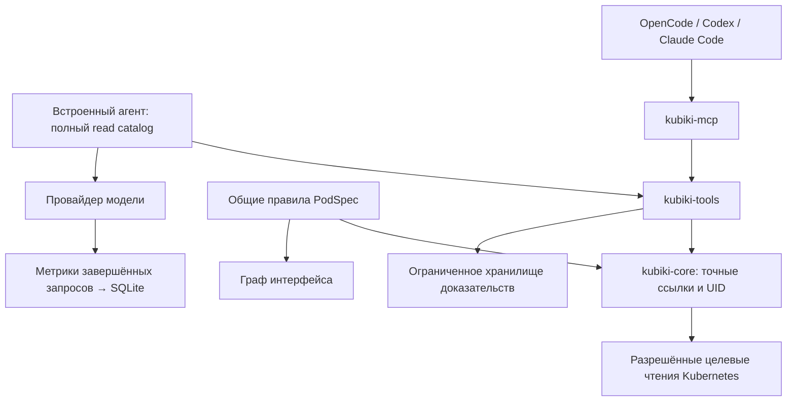

# ADR-008: Связанная диагностика, полный каталог чтения и внешние агенты

Статус: **Accepted** — направление реализации согласовано пользователем; сокращённые наборы read tools по intent отклонены. Ограничения реализации перечислены ниже.

## Проблема

В сохранённом расследовании `caretta-sql4j` модель трижды обращалась к неподтверждённому Deployment или списку Deployments. `get_pod_diagnostics` раньше терял `metadata.ownerReferences`. Связи в интерфейсе вычислялись в TypeScript и не были доступны агенту как обход графа. Замена модели или собственного цикла на внешний CLI сама по себе эти данные не добавляет.

Разбор диалога и сравнение MCP: [отчёт](../reviews/2026-11-03-mcp-pod-investigation.md).

## Принятое решение

Это модули существующего приложения, без новых сервисов. Авторизация и проекция полей остаются в backend. Renderer не задаёт разрешения на чтение.

### Полный каталог и фазы

В Plan остаются **все разрешённые инструменты чтения**, включая специальные диагностики, поиск объектов, Helm/Flux/Argo при их доступности и просмотр доказательств. В Action добавляются разрешённые мутации. Backend независимо проверяет фазу и права при исполнении; отсутствие инструмента в prompt не заменяет проверку.

Переключение фаз не создаёт новую беседу, не удаляет evidence и не переписывает provider-native reasoning. Активный запрос останавливается при изменении фазы; следующий запрос получает актуальный каталог с сохранённой историей. Размер контекста может меняться, поэтому при достижении бюджета действует обычное сжатие истории.

`resource_catalog` сохраняет реестр встроенных типов и добавляет `discover=true` для live API discovery, включая CRD. `group` ограничивает группу, `page` продолжает выдачу по 100 типов. Это лимит ответа, а не общего числа доступных типов или объектов. Для чтения объектов сохраняются существующие страницы/cursors и точные GVK-запросы.

### Связи и диагностика

- `get_pod_diagnostics` возвращает разрешённые ownerReferences. Владелец не выводится из имени Pod.
- `get_neighborhood` обходит точные ссылки: owner chain с проверкой UID, Node, зависимости PodSpec, PVC/PV/StorageClass, StatefulSet Service, HPA target, Ingress, EndpointSlice, RBAC. Для неизвестного владельца discovery определяет область видимости.
- Общие декларативные [правила PodSpec](../../shared/pod-reference-rules.json) используются Rust resolver и графом интерфейса. Правила для всех остальных специальных связей UI пока не перенесены в единый движок.
- Обратные связи ищутся ограниченными namespace-страницами: Pod → выбирающие Services; ConfigMap/Secret/PVC/ServiceAccount → использующие Pods; Service → EndpointSlices; CronJob → Jobs. Контроллеры связываются с дочерними объектами по selector и owner UID. Selector сам по себе не означает владение.
- Обход по умолчанию: 2 перехода, 25 узлов; запрос допускает до 4 переходов / 100 узлов. Есть ограничения очереди/размера, общие deadline и read budget. `omitted`, `truncated`, `continuationQueries` и coverage явно обозначают неполноту. Продолжение — новый корень, следующие страницы или отдельные инструменты.
- `diagnose_resource` собирает здоровье и neighborhood параллельно, затем UID-bound events и разрешённые логи. Для Pod — до двух проблемных контейнеров, по 80 строк; previous выбирается при restartCount > 0. `includeLogs=false` отключает сбор. Подмена UID между наблюдениями не объединяется в одно доказательство.
- Большие части bundle сохраняются в evidence store и заменяются частичным excerpt с ID. Подробности можно запросить через `get_evidence`. Если сохранение невозможно, требуется более узкое живое чтение; excerpt не доказывает отсутствие проблемы.

Этот граф не является полным атомарным снимком кластера. Специальные GitOps/Gateway и прочие связи остаются доступны через полный каталог соответствующих инструментов/объектов; нельзя заявлять полный паритет topology UI и MCP.

### Контекст и тупики

Описания инструментов и системный prompt сокращены без удаления типов аргументов, проверок и read tools. Полные описания установленных skills убраны из каждого запроса: `list_skills` раскрывает их по запросу, `read_skill` сохраняет доступ ко всем установленным именам.

Старые успешные read results больше 6 KB заменяются частичным excerpt и evidence ID; последняя пачка результатов, квитанции изменений и provider-native reasoning не затрагиваются. Исторические доказательства имеют срок/лимит хранения и не подтверждают результат последующей мутации. При необходимости их нужно перечитать.

После двух NotFound для одной GVK/namespace/name дальнейшее повторение через другое диагностическое имя блокируется локально в рамках текущего пользовательского запроса. Новый запрос пользователя или изменение состояния через мутацию позволяют повтор. Ошибки точного Pod/workload чтения теперь различают 404 и запрет доступа. Это ограниченный детектор, не универсальный классификатор всех ошибок.

Существующие дедупликация чтений и discovery cache сохранены. Новый кэш устаревающих результатов после записи не добавлялся.

### Метрики и интерфейс

SQLite больше не обнуляет input/output totals. Сохраняются текущий context estimate/budget и последние 100 записей завершённых генераций: запрошенная/возвращённая модель, фаза, оценки system/tools/history, фактические input/output при наличии, cached input, reasoning output, длительность, время первого текстового токена и число предложенных инструментов. Anthropic input учитывает обычные, cache-read и cache-creation input tokens.

В чате `Request costs` показывает последние 10 запросов. Оценки помечены `≈`, отсутствующие provider-показатели не выдаются за измеренные нули. Время первого текстового токена может отсутствовать для tool-only completion. Незавершённые/оборванные ответы не образуют полного billing ledger. Метрики внешних CLI принадлежат самим CLI.

Thinking во встроенном чате изначально свёрнут, в том числе при стриминге. Пользователь может раскрыть его вручную. Это настройка отображения, она не отключает reasoning модели и не уменьшает его генерацию.

### Внешние агенты

В Settings → Agent добавлены Codex и Claude Code рядом с OpenCode. Для каждого сохраняются отдельные executable/workspace настройки. Общие PTY, остановка, отмена незавершённого старта, изоляция окна/кластера и attached MCP остаются прежними.

Codex получает session-scoped TOML override `-c mcp_servers.kubiki=...`; Claude Code — `--mcp-config` с JSON. Prompt передаётся одним аргументом после `--`. Их глобальные конфиги не перезаписываются, bypass-permissions флаги не добавляются. Требуются установленный CLI и его собственная авторизация. OpenCode использует V2 с каталогом Code Mode и default_agent=plan; workspace-инструкция задаёт путь к Kubiki и остановку при недоступном MCP. Глобальная конфигурация не перезаписывается.

CLI управляет своим диалогом, моделями и подтверждениями. Фазы CLI не синхронизируются с backend-фазой Kubiki автоматически: attached MCP работает с выделенной внешней политикой, как ранее OpenCode. Для OpenCode дополнительно настроены запреты мутаций Kubiki в Plan на стороне CLI. Встроенные переключатели Plan/Action относятся к Kubiki runtime.

Справка интеграции: [Codex MCP](https://developers.openai.com/codex/mcp/), [Codex CLI](https://developers.openai.com/codex/cli/reference/), [Claude Code CLI](https://code.claude.com/docs/en/cli-reference). Локально проверены версии/help Codex 0.166.0 и Claude Code 2.1.299; платная модельная сессия не запускалась.

## Измеренный размер контекста

Оценщик `memory::estimate_tokens`: ASCII bytes / 3 с округлением, non-ASCII символы отдельно, плюс 8. Это **не tokenizer и не счёт провайдера**. Tools сериализованы в OpenAI-compatible shape. Взяты текущая локальная policy Ask/Plan, 8 установленных skills и два варианта capabilities. Настройки того старого запроса не сохранялись, поэтому baseline — реконструкция.

| Компонент | До изменений | После |
|---|---:|---:|
| Каталог core + skills | 6 514 / 23 tools | 5 545 / 26 tools |
| Каталог со всеми интеграциями | 7 268 / 29 tools | 6 299 / 32 tools |
| Базовый SYSTEM_PROMPT | 1 467 | 779 |
| Новая общая guidance | — | 278 |

Каталог уменьшился на 13–15%, несмотря на добавление трёх инструментов. Базовый prompt сократился на 47%; новая guidance считается отдельно. Scope, phase, policy, пользовательская история и ответы инструментов добавляются сверху. Прежняя оценка первого запроса — 8,6–9,4k до tool results. Цель 3–4k, обсуждавшаяся для урезанного каталога, **отозвана**: пользователь выбрал полный read catalog.

Исходные данные: [baseline](../reviews/2026-11-03-ai-context-cost.json), [после изменений](../reviews/2026-11-03-ai-context-after.json). В baseline `after_fix` означает только первый точечный ownership fix, а не итог этой реализации.

В старом диалоге сохранены 8 сообщений и 5 tool calls; три ушли на неподтверждённый Deployment/список Deployments. Из 1 455 символов двух текстов модели 1 117 (~77%) находились внутри thinking. Backend обнулял usage и удалял тела ответов tools, поэтому точный суммарный расход, cache hits, тариф и самый большой фактический ответ восстановить нельзя. Нули не означают бесплатный диалог.

## Отличия от Radar и пределы результата

[Neighborhood Radar](https://github.com/skyhook-io/radar/blob/4fa114de070f32d7a59db5b746cee619292ddc39/internal/mcp/tools_neighborhood.go) использует общий topology builder и bounded BFS, но просмотренный MCP-путь строит весь граф заново. Здесь используются целевые разрешённые чтения без полной перестройки кластера на каждый Pod. [Компактная guidance](https://github.com/skyhook-io/radar/blob/4fa114de070f32d7a59db5b746cee619292ddc39/pkg/investigation/guidance.go) и [CLI-адаптеры](https://github.com/skyhook-io/radar/blob/4fa114de070f32d7a59db5b746cee619292ddc39/internal/ai/agent.go) дают полезный архитектурный ориентир.

Bundle сокращает необходимость отдельных model round trips, но фактическое ускорение p50/p95 и качество диагнозов требуют сравнения на одной модели и одинаковых инцидентах. Такие live-model измерения здесь не проводились. Полный перенос всех topology relations, tool-duration/API-byte ledger и поведенческая оценка на реальной модели остаются отдельными расширениями; не выдаём их за выполненную работу.

## Проверка и остановка тестирования

До просьбы пользователя прекратить тесты успешно завершились frontend unit/browser suites, встроенный runtime и native library checks; отдельные fixtures проверили DaemonSet, цепочку ReplicaSet/Deployment, UID replacement, скрытые ссылки, циклы, reverse selector pagination, previous logs, custom cluster owner и каталог из 125 CRD. Пользователь затем попросил не тратить время на тесты/их логи: последующие сокращения текстов каталога и небольшая правка таблицы метрик повторно не прогонялись. Release desktop не пересобирался, live-кластер не изменялся. После уточнения о Code Mode и CRD watch собран debug-бинарник без запуска тестов.

Последующее расследование OpenCode подтвердило ошибку выбора каталога и разовый характер чтения CRD. Реализация, новые фактические usage counters и ограничения описаны в [дополнении](../reviews/2026-11-03-opencode-and-crd-watch.md).
