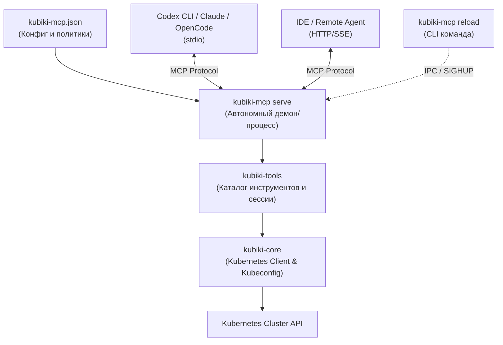

# 009: Автономный MCP-сервер Kubiki и единая система разрешений инструментов

Дата: 2026-11-08. Статус: **принято (архитектурное обособление); вынос в полностью автономный бинарник/демон зафиксирован как задумка на будущее (roadmap)**.  
Владелец: разработчики Kubiki core / MCP / AI.  
Развивает и уточняет: [ADR-002](002-integrated-ai-agent.md), [ADR-003](003-shared-kubernetes-access-and-ai-phases.md), [ADR-007](007-portable-cluster-tools-and-opencode.md) и [ADR-008](008-evidence-first-investigation.md).

---

## 1. Контекст и проблемы

В текущей архитектуре Kubiki (на этапе после ADR-007):
1. **Разрозненность моделей разрешений**:
   * Для встроенного агента Kubiki использовалась модель `policy: AgentPolicy` с вкладками "Data access", "Confirmations", "Scope & rules" в модальном окне настроек.
   * Для внешних агентов (OpenCode, Codex, Claude Code) использовался отдельный блок `mcpPolicy` с кнопкой "MCP Tools (X/31)" и панелью Live MCP Access.
   * Встроенный агент Kubiki не имел удобной, наглядной панели быстрого переключения инструментов MCP прямо в чате (была лишь общая кнопка "Permissions").
2. **Отсутствие разделения инструментов по фазам Plan / Action**:
   * В фазе `Plan` инструменты записи блокируются автоматически (`phase == Action` проверка в `catalog.rs`), однако пользователь не мог гранулярно настроить, какие именно инструменты чтения/диагностики разрешены в `Plan`, а какие — в `Action`.
3. **Неочевидная связка операций записи и инструментов**:
   * В строке `write operations` присутствуют операции `create`, `update`, `delete`, `scale`, `restart`.
   * При этом инструмент `apply_manifest` покрывает **одновременно** `create` и `update`. При отключении одного лишь `update` инструмент `apply_manifest` оставался активным (так как `create` разрешен). Пользователю это неочевидно и требует явной визуализации и подсказок.
4. **Архитектурная граница MCP**:
   * Для того чтобы в будущем была возможность безболезненно вынести MCP в независимый продукт или бинарник без переписывания приложения, слой инструментов и протокола должен быть строго обособлен (изолирован от Tauri, UI и оконной среды).
   * Сам запуск в виде полностью внешнего отдельного сервиса/демона с автономным k8s-ядром отложен на будущее, но интерфейсы и контракты изолируются уже сейчас.

---

## 2. Принятые решения

### 2.1. Изоляция слоя MCP и статус выноса в отдельный бинарник

Принято двухфазное решение:
1. **Текущий этап (Реализовано: Полное обособление слоя MCP)**:
   * Крейты `crates/kubiki-tools` и `crates/kubiki-mcp` полностью очищены от любых зависимостей от Tauri, GUI, окон и UI-состояния.
   * Все взаимодействие строится через чистые контракты: `AgentPolicy`, `ToolDefinition`, `ClusterServer`, `Session` и стандартный протокол MCP (`rmcp`).
   * В приложении реализована единая панель управления инструментами и правами (для встроенного агента и внешних агентов) с разделением Plan/Action.
   * Связка приложения с внешними агентами работает через легковесный защищенный bridge (сокет/pipe с bootstrap токеном).

2. **Задумка на будущее (Roadmap / Фаза 2: Standalone CLI и автономный демон)**:
   * Выделение `kubiki-mcp` в полностью самостоятельный CLI-бинарник, скачиваемый и работающий автономно без Kubiki Desktop.
   * Собственный демон управления с декларативным `kubiki-mcp.json` и командами `kubiki-mcp serve`, `kubiki-mcp init`, `kubiki-mcp reload` (SIGHUP/IPC).
   * Автономный пул подключения к k8s без опоры на контексты десктопного менеджера сессий.
   * Благодаря изоляции крейтов на первом этапе, реализация этой задумки не потребует переписывания логики внутри десктопного приложения — достаточно будет подключить standalone-бинарник как внешний процесс по стандартному stdio/IPC.



### 2.2. Интерфейс командной строки `kubiki-mcp`

Бинарник `kubiki-mcp` предоставляет стандартный набор подкоманд:
1. `kubiki-mcp serve [--config PATH] [--context NAME] [--namespace NAME] [--read-only]`:
   Запуск MCP-сервера. Автоматически создает локальный управляющий сокет IPC (`/tmp/kubiki-mcp-<pid>.sock` или в `XDG_RUNTIME_DIR`) для приема сигналов управления.
2. `kubiki-mcp init [--out PATH]`:
   Генерация эталонного, подробно прокомментированного файла конфигурации `kubiki-mcp.json`.
3. `kubiki-mcp validate [--config PATH]`:
   Проверка синтаксиса конфигурации, соответствия схеме и доступности указанного контекста кластера Kubernetes.
4. `kubiki-mcp reload [--config PATH] [--socket PATH]`:
   Отправка сигнала перезагрузки работающему процессу `kubiki-mcp`. Сервер перечитывает конфиг, обновляет права в памяти и рассылает клиентам нотификацию `notifications/tools/list_changed` через MCP-протокол.
5. `kubiki-mcp attach <bootstrap>`:
   Сохраняется для прозрачной интеграции с процессами, запущенными из десктопного приложения Kubiki.

### 2.3. Спецификация конфигурации `kubiki-mcp.json`

```json
{
  "$schema": "https://kubiki.dev/schemas/mcp-v1.json",
  "version": 1,
  "cluster": {
    "context": "my-k8s-cluster",
    "kubeconfig": null,
    "namespaces": ["default", "production"],
    "allNamespaces": false
  },
  "policy": {
    "readOnly": false,
    "writes": ["create", "update", "scale", "restart", "delete"],
    "maxReplicas": 10,
    "data": {
      "resources": true,
      "events": true,
      "logs": true,
      "metrics": true,
      "clusterResources": true,
      "secrets": "none",
      "configMaps": "metadata",
      "customResources": "metadata"
    },
    "integrations": {
      "helm": "auto",
      "argocd": "auto",
      "flux": "auto"
    },
    "phases": {
      "plan": {
        "disabledTools": []
      },
      "action": {
        "disabledTools": []
      }
    },
    "disabledTools": [],
    "deniedPaths": []
  },
  "server": {
    "transport": "stdio",
    "instructions": null
  }
}
```

### 2.4. Единая панель управления инструментами MCP в UI

1. **В чате встроенного агента Kubiki (`AgentView`)**:
   * Кнопка `Permissions` заменяется на компактную информативную кнопку **`MCP Tools (X/31)`** (аналогично панели OpenCode).
   * При клике открывается всплывающая / выпадающая панель быстрого управления правами с вкладками **Plan** и **Action**, где в реальном времени видны активные инструменты и их статус.
2. **В настройках (`AgentSettings`)**:
   * Раздел **"Cluster tools & data" (MCP)** становится доступным **всегда**, независимо от того, какой runtime выбран — Kubiki, OpenCode, Codex или Claude.
   * Конфигурация MCP-инструментов хранится централизованно и является единым источником прав для всех агентов.
3. **Визуализация связки Write Operations -> Tools**:
   * В строке операций записи рядом с чекбоксами `create` и `update` добавляется поясняющая плашка: `create/update → apply_manifest`.
   * При снятии одного флага (например `update`) интерфейс наглядно отображает, что инструмент `apply_manifest` все еще активен благодаря флагу `create`.

---

## 3. Последствия

### Положительные (Positive)
* **Портативность**: `kubiki-mcp` можно использовать в терминале, скриптах, CI/CD, Claude Desktop или любых других редакторах без установки и запуска полного GUI Kubiki.
* **Предсказуемость**: единые правила и единая панель инструментов для встроенного агента Kubiki и внешних агентов (Codex, OpenCode, Claude).
* **Live-reload**: изменение настроек в конфиге или в UI мгновенно обновляет каталог инструментов у подключенных агентов без перезапуска процессов и потери контекста диалога.
* **Тонкий контроль Plan/Action**: возможность запретить ресурсоемкие или шумные диагностические вызовы в фазе планирования или ограничить действия в фазе применения.

### Отрицательные (Negative)
* Необходимость поддерживать CLI-парсер и IPC-сокет управления в `kubiki-mcp`.
* Дополнительные структуры конфигурации для разделения инструментов по фазам Plan/Action.

### Нейтральные (Neutral)
* Существующая семантика подтверждений десктопа (desktop host consent) остается активной при запуске из GUI и прозрачно отключается в чистом CLI (где подтверждениями управляет внешний агент).

---

## 4. Связанные ссылки
* [ADR-007: Переносимый модуль инструментов кластера](007-portable-cluster-tools-and-opencode.md)
* [AI_AGENT.md](../AI_AGENT.md)
* [AI_PLAN_CONTRACT.md](../AI_PLAN_CONTRACT.md)
