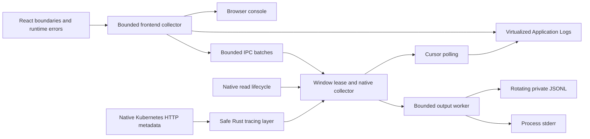

# 014: Local, bounded developer diagnostics

## Status

Accepted, 2026-11-18. Implemented by the current change; operating details and
validation limits are in [Application diagnostics](../DIAGNOSTICS.md).

## Context

Kubiki's reads, watches, IPC commands and UI state span React, Tauri and portable
Rust libraries. Raw console messages and OS-specific terminal output do not give
an AI debugger a correlated, bounded history. Unrestricted logging would also
capture Kubernetes and AI payloads, overload the interface or block critical work.
Developer mode already controls local diagnostic features and must own this one.

Quality requirements are bounded memory/disk/queues, nonblocking producers,
visible loss/failure states, revocable per-window capture and safe metadata rather
than payload copies. Application data access and mutation authorization must be
unchanged. Desktop and browser transports have different observability limits.

## Decision

Use the existing workbench panel registry for **Application Logs**. Developer mode
controls its registration and capture; a hidden/closed view does not own collection.
A shared JSON contract defines the local OTel-aligned event model and admitted
attributes. It does not introduce an OTel Collector, remote exporter or OTLP API.

Observe Kubernetes HTTP metadata at the pooled client's transport boundary, below
cache/policy/budget wrappers. Preserve method/status/route and page/watch semantics,
while never observing headers or bodies. A shared trace ID links frontend managed
reads to native spans; native HTTP spans have distinct random IDs. HTTP duration
ends at response headers. Workload health and stream lifetime remain separate.

Use a bounded ring, admission limits and bounded output queues. Drop under pressure
and report counters; application producers do not wait for disk or stderr. Apply
native configuration in monotonic per-window order. Revoked leases, replaced
captures and late frontend replies cannot reactivate a stopped capture.

## Alternatives considered

- **Monkey-patch console and serialize arbitrary Rust events**: broad coverage but
  captures prompts, Secrets, credentials and large response objects. Rejected.
- **A full OTel SDK/Collector/exporter stack**: useful for centrally operated services,
  but adds dependencies, remote-configuration/security boundaries and operational
  costs to a local desktop debugging feature. Keep an aligned envelope now;
  revisit an explicit exporter only with a concrete operator need and consent model.
- **Only a React store and download button**: simple, but misses backend-only
  requests and does not support terminal/AI tailing after the view closes.
- **Synchronous disk/console writes from request handlers**: smaller implementation,
  but a slow pipe or filesystem failure could block Kubernetes work. Rejected.
- **Persistent unbounded debug files**: convenient for long history, but unsafe in
  a desktop process. Fixed local retention and explicit export are sufficient.

## Consequences

The feature is opt-in, local and bounded, with useful cross-layer correlation and
reviewable metadata. No logging code grants Kubernetes access or replaces native
confirmations, operation receipts or verification.

Costs include an output thread, bounded duplicate buffers/queues, 250 ms native
polling and metadata projection work. Rate limiting and rotation deliberately
sacrifice completeness; abrupt shutdown can lose queued events. Free-form error
messages are absent, so categories, request metadata, source locations and normal
resource inspection must be used together.

The HTTP boundary does not intercept traffic inside external kubectl/Helm CLIs.
Browser captures and synthetic IPC fixtures do not prove installed WebView or OS
ACL behavior. The logging guide documents these limits and current checks.

## References

- [Application diagnostics](../DIAGNOSTICS.md)
- [Local state](../LOCAL_STATE.md)
- [Workbench panel slots](004-workbench-layout-shell-and-perspective-panels.md)
- [Shared contract](../../shared/diagnostics-contract.json)
- [OpenTelemetry Logs Data Model](https://opentelemetry.io/docs/specs/otel/logs/data-model/)
- [W3C Trace Context](https://www.w3.org/TR/trace-context/)
- [OWASP Logging Cheat Sheet](https://cheatsheetseries.owasp.org/cheatsheets/Logging_Cheat_Sheet.html)
