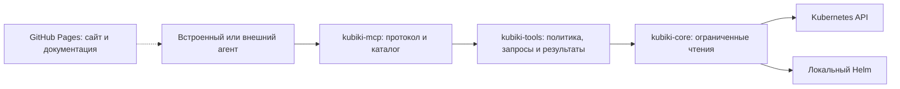

# Развитие MCP и сайт проекта

Статус: **In progress**. Сроки и состав релизов не утверждены.
Текущие возможности и ограничения описаны в [AI agent](../AI_AGENT.md#tools-and-execution-limits),
границы доступа — в [ADR-005](../decisions/005-bounded-ai-resource-queries.md) и
[ADR-009](../decisions/009-standalone-mcp-server-and-unified-tool-permissions.md).
Управляемая конфигурация и перезагрузка MCP рассматриваются в
[отдельном плане](mcp-lifecycle.md).

## Цели и текущая точка

Сделать MCP удобнее для расследования проблем в кластере: понятный каталог,
управляемые выборки логов и событий, полезные сценарии для Helm, Argo CD и Flux.
Отдельная цель — публичный сайт проекта на GitHub Pages.

Уже существуют общие `get_resource`/`list_resources` с курсорами, диагностические
инструменты, ограниченные логи и события, а также специализированные чтения Helm,
Argo CD и Flux. GitOps и Helm операции записи через агента сейчас не разрешены.
`get_logs` предлагает диагностическую сводку и точные строки ограниченного снимка
с фильтром подстроки, временным окном и курсорами; `get_events` поддерживает
продолжение, фильтры имени/UID, типа, причины и времени, а timeline сортирует и
дедуплицирует только прочитанную ограниченную выборку. `get_metrics` возвращает
фактические Pod/Node CPU/RAM, budgets и ограниченные суммы reservations/limits.
Для CRD добавлен уровень `Diagnostic fields`: известные поля Flux и
external-secrets доступны без values и произвольного spec. Явный запрет и ранее
сохранённый metadata-only доступ сохраняются; generic reads объясняют запреты полей.
События не дают гарантии последних записей всего кластера. Специализированные GitOps-списки ограничены и могут быть неполными.

Реализованные контракты: [AI agent](../AI_AGENT.md#tools-and-execution-limits).
Выбор снимка логов и его ограничения описаны в
[ADR-012](../decisions/012-bounded-log-snapshot-pages.md).
React-сайт в `website/` и workflow сборки/сохранения в `gh-pages` подготовлены.
Публикация ещё не подтверждена; см. [Website](../WEBSITE.md).
Ниже сохранены этапы и критерии проверки. Реализованные части перечислены выше;
оставшиеся проверки стоимости, клиентов, live-поведения и публикации остаются планом.

## Проверенные пересечения каталога

| Семейства | Пересечение и решение |
| --- | --- |
| `get_resource` / `list_resources` и Flux list/get | Flux добавляет нормализованные conditions/revisions и сводку ограничений. Сохранить тонкие обёртки над общей проекцией; для глубокого обхода использовать generic cursors. |
| `diagnose_resource` / `get_neighborhood` / отдельные diagnostics | Bundle объединяет свидетельства, граф раскрывает связи, отдельные инструменты дают детали. Сохранить разные сценарии; не удалять по совпадению полей. |
| `get_events` / `get_events_timeline` | Общий источник, но пагинация API и дедуплицированная страница имеют разные гарантии. Согласовать фильтры, сохранить имена для клиентов. |
| `get_metrics` для Pod и Node | Один инструмент расширен параметром kind; отдельные новые инструменты для каждого вида не нужны. |
| Helm inventory и Flux HelmRelease | Разные объекты: запись Helm storage и декларация контроллера. Не добавлять отсутствующие storage-релизы в Helm-таблицу. |

Удалений и несовместимых переименований нет. Матрица стоимости и сравнительная
проверка клиентских расследований остаются отдельной частью полного аудита.
Desktop UI уже разделяет Helm Overview и общую типизированную таблицу,
не блокирует Helm-команды из-за Flux и предлагает Reconcile/Retry через backend.
Это не расширяет write allowlist MCP: записи GitOps через агента по-прежнему закрыты.

## Предлагаемая архитектура

Существующие границы сохраняются: backend проверяет scope, права и проекцию;
параметры инструмента могут только сузить доступ. Результаты показывают покрытие,
ограничения и ошибки, а принятие операции не объявляется здоровьем workload.
Важны ограничение запросов, памяти и времени, отмена, изоляция контекста и UID,
совместимость клиентов и защита данных. Данные кластера остаются недоверенными.

## Этап 1. Аудит и упрощение каталога MCP

1. Составить таблицу всех инструментов: сценарий, входы/выходы, права, стоимость,
   лимиты, доступность в разных хостах и пересечения с общими инструментами.
2. Сравнить диагностические и общие инструменты на реальных сценариях: что даёт
   специализированный инструмент и когда он скрывает нужную детализацию. Проверить
   описания и схемы на неоднозначность, а также обнаружение возможностей и policy.
3. Предложить точечные изменения: понятные параметры и ошибки, единые признаки
   неполноты, согласованные описания и права. Не считать похожие имена доказательством
   избыточности: специализированный инструмент может экономить запросы и контекст.
4. Для каждого кандидата на удаление описать замену, влияние на клиентов, правила
   миграции и период совместимости. Удаление — отдельное решение после аудита.

**Готово, когда:** каталог и матрица пересечений проверены по коду и тестам;
для каждого изменения известны пользовательская выгода, влияние на права и план
совместимости; поведение встроенного агента и standalone MCP проверено контрактными
тестами. Результат аудита может подтвердить необходимость оставить все инструменты.

## Этап 2. Логи и события: оставшаяся валидация

**Реализовано:** Event API continuation с query/policy-bound курсорами;
фильтры имени/UID, типа, причины и времени; точные страницы ограниченного log-снимка,
подстрока и временное окно. Timeline сортирует и дедуплицирует одну страницу.
Контракты и лимиты находятся в [AI agent](../AI_AGENT.md#tools-and-execution-limits),
выбор log-снимка — в [ADR-012](../decisions/012-bounded-log-snapshot-pages.md).

Fixture-тесты проверяют привязку курсоров, отзыв доступа, продолжение после пустой
отфильтрованной страницы, неизменность строк снимка и отсутствие повторного чтения.
Остаётся сопоставить эти гарантии с ротацией логов, рестартами, истечением Events и
большими реальными выборками на read-only окружении. Глобальная хронология событий,
долговременный архив логов и lossless live resume не обещаются.

**Готово, когда:** клиентские сценарии и live-проверки подтверждают
задокументированные границы; выявленные расхождения отражены в коде и guides.

## Этап 3. Helm, Argo CD и Flux

1. Инвентаризировать существующие list/get, поддерживаемые виды ресурсов, версии
   API, обнаружение интеграций, доступ к содержимому и различия с общими запросами.
2. Для каждого продукта описать сценарии: найти проблемный релиз/приложение,
   понять состояние и ревизию, перейти к связанным ресурсам и событиям. Определить,
   каких данных действительно не хватает и можно ли получить их текущими tools.
3. Добавлять специализированные чтения только при подтверждённой пользе; учитывать
   частичное покрытие, отсутствующие CRD, RBAC, версии контроллеров и лимиты Helm
   subprocess. Не раскрывать values, секреты или поля, запрещённые политикой.
4. Sync/reconcile и Helm install/upgrade/rollback — отдельное решение о продуктовой
   необходимости и безопасности: модель прав, подтверждение, identity, конкурентные
   изменения, receipt и проверка результата. До этого сохраняется запрет на запись.

**Готово, когда:** для согласованных сценариев есть контракт и тесты доступных,
отсутствующих и запрещённых интеграций, ограниченных/частичных ответов и защиты
данных; обновлены операционные документы. Отсутствие интеграции не выглядит как
здоровое состояние. Любое расширение write allowlist требует отдельного согласования.

## Этап 4. GitHub Pages

Согласовать назначение сайта: знакомство с Kubiki, установка и переход к документации;
определить аудиторию, структуру, язык, домен и источник публикации. Начать с простой
статической публикации через GitHub Actions; сравнить прямой статический сайт и
генератор документации после определения объёма. Существующие guides должны оставаться
каноническим источником: выбрать способ сборки или ссылок без ручного дублирования.

Определить правила публикации для основной ветки, права workflow, зависимости и
rollback; проверить base path репозитория, внутренние ссылки, мобильную доступность,
отсутствие приватных данных и работоспособность страницы установки. Пользовательский
домен, аналитика и интерактивные сервисы не входят в исходный объём без решения.

**Готово, когда:** утверждены содержимое и адрес, сайт воспроизводимо собирается,
проверяется и публикуется, основные ссылки работают на опубликованном адресе, а
инструкции сопровождения и восстановления описаны. Настройки Pages и доступность
публикации в конкретном репозитории нужно проверить при реализации.

## Порядок и решения для обсуждения

Аудит MCP предшествует изменению каталога и уточняет этапы 2–3. Контракт событий и
логов можно разрабатывать параллельно с анализом интеграций; сайт независим от MCP.
Каждый этап можно разбить на отдельные изменения с собственными тестами и документацией.

- Какие сценарии расследования и клиенты важнее всего для первого результата?
- Нужны ли только чтения интеграций или в будущем необходимы управляемые операции?
- Что важнее для логов: точное продолжение ограниченного снимка или свежие окна с
  явно возможными пропусками и повторами? Какой допустим объём хранения?
- Сайт — только landing page со ссылками или полноценный портал документации;
  какой язык и адрес нужны?

Предлагаемые решения не являются принятыми ADR. После обсуждения значимые изменения
границ доступа, контрактов продолжения или публикации следует оформить отдельными
ADR по [шаблону](../decisions/TEMPLATE.md), с альтернативами, последствиями и
связями с существующими решениями. До реализации согласовать план с владельцем.

## Новые задачи по диагностике Pod и MCP

Статус — предложено. Для полей, которые инструменты уже запрашивают, сначала
воспроизвести результат через внешний MCP с тем же уровнем доступа.

| Задача | Критерий приёмки |
| --- | --- |
| Requests в карточке Pod | Видны запрошенные CPU и память по контейнерам и эффективный запрос Pod с учётом init-контейнеров и overhead. Отсутствующий request отличим от измеренного потребления. |
| Размещение Pending Pod в UI и MCP | Для назначенного Pod доступны разрешённые политикой `spec.nodeName` и conditions. До назначения UI и MCP показывают, что нода ещё не выбрана, и приводят доступное объяснение PodScheduled или FailedScheduling. |
| Полное сообщение scheduler | На примере длинного FailedScheduling можно дочитать все причины отказа, включая текст после первых 160 символов. Ноды называются только когда их указывает источник. |
| Pod по нодам | MCP позволяет сгруппировать Pod по nodeName и получить список для одной ноды с requests и доступными метриками CPU/RAM. Видны границы выборки по namespace и страницам. |
| Смена кластера и профили MCP | Пользователь задаёт контекст, namespace и политику отдельно для каждого подключения MCP. После смены кластера запросы используют новый профиль, старые курсоры и подтверждения утрачивают силу. См. [план конфигурации](mcp-lifecycle.md). |
| Медленная загрузка списка Pod | На воспроизводимом наборе измерить время от открытия списка до первых строк и до полной загрузки при холодном и повторном открытии. Сравнить до и после исправления в одинаковых условиях и проверить отмену при смене контекста. |
| Подмена поискового запроса | После ввода `qdrant`, выбора любого найденного Pod и возврата строка поиска сохраняет `qdrant`. Покрыть последовательность браузерным тестом. |
| Проверка наличия релиза в Helm storage | Для заданных context, namespace и release MCP различает найденную ревизию, подтверждённое отсутствие и недоступность storage. Начать с проверки существующего Helm inventory. Содержимое Secret для ответа не требуется. |
| История метрик | Для интервала до инцидента вернуть доступные временные ряды Pod и Node с источником, временем наблюдений и пробелами. При отсутствии источника истории явно сообщить об этом. |
| Статусы Flux | На HelmRelease, Kustomization и GitRepository проверить generic и Flux reads. При разрешённом диагностическом доступе доступны conditions и соответствующие виду revisions, при ограничении доступа видна причина отсутствия полей. |
| Events по всем разрешённым namespace | Один запрос с фильтром involvedObject позволяет получить полный доступный текст с продолжением. Проверить одноимённые объекты разных namespace, фильтр по UID и частичный доступ. |
| Предпросмотр Helm | Для заданных chart, версии и values показать результат рендера до reconcile. Проверить ошибки шаблонов, защиту чувствительных значений и отсутствие записи в кластер. |
